<p align="center">
  <a href="README.md">Русский</a> | <a href="README.en.md">English</a> | <b>Deutsch</b>
</p>

# Breitbandige aperturgekoppelte gestapelte Mikrostreifen-Patchantenne mit zirkularer Polarisation für das Ka-Band (28–30 GHz)

Dieses Repository dokumentiert die Auslegung, die analytische Berechnung, CAD-Modelle sowie die dreidimensionale elektromagnetische Simulation einer breitbandigen zirkular polarisierten Mikrostreifen-Patchantenne für das Ka-Band im Frequenzbereich 28.0–30.0 GHz. Die Antenne basiert auf einer schlitzgekoppelten Aperturstruktur (Cross-Slot) in Verbindung mit einem gestapelten parasitären Resonator (Stacked Patch) zur Breitbandanpassung und Vergrößerung der Zirkularpolarisationsbandbreite.

## Inhaltsverzeichnis

[Projektübersicht](#projektübersicht)<br>
[Projektstruktur](#projektstruktur)<br>
[Analytische Berechnung](#analytische-berechnung)<br>
[3D-Modellierung und Optimierung des Einzelstrahlers](#3d-modellierung-und-optimierung-des-einzelstrahlers)<br>
[Ergebnisse der elektromagnetischen Simulation des Einzelstrahlers](#ergebnisse-der-elektromagnetischen-simulation-des-einzelstrahlers)<br>
[Untersuchung des 8x8-Antennenarrays und Oberflächenwelleneffekte](#untersuchung-des-8x8-antennenarrays-und-oberflächenwelleneffekte)<br>
[Unterdrückung von Oberflächenwellen durch Masseflächen-Perforation und Neujustierung des Strahlers](#unterdrückung-von-oberflächenwellen-durch-masseflächen-perforation-und-neujustierung-des-strahlers)<br>
[2×2-Teilarray mit sequentieller Phasen- und Raumrotation](#22-teilarray-mit-sequentieller-phasen--und-raumrotation)<br>
[Lizenz](#lizenz)

## Projektübersicht

Die Antenne ist für breitbandige Anwendungen im Ka-Band (28.0–30.0 GHz) konzipiert, darunter Millimeterwellen-Satellitenverbindungen, Radarsysteme und drahtlose Hochfrequenz-Frontends.

Wesentliche Architekturmerkmale:

Topologie: Mehrlagige gestapelte Mikrostreifen-Patchantenne (Stacked Patch).<br>
Anregungsmechanismus: Berührungslose elektromagnetische Aperturkopplung über einen kreuzförmigen Schlitz (Cross-Slot) in der Massefläche, gespeist durch eine Mikrostreifenleitung.<br>
Anpassung: Zentrierte leerlaufende Lambda/Viertel-Anpassungsleitung ($\lambda_g/4$ Tuning Stub), platziert unmittelbar über dem Aperturkreuz zur Kompensation der Schlitzreaktanz.<br>
Zirkulare Polarisation: Diagonale Eckenabschrägungen (Corner Truncation, $45^\circ$) auf den Resonatorelementen zur Anregung zweier orthogonaler Moden ($TM_{10}$ und $TM_{01}$) in Quadratur ($90^\circ$ Phasenverschiebung).<br>
Bandbreitenvergrößerung: Ein über dem Hauptstrahler angeordneter parasitärer Resonator zur Erzeugung eines doppelresonanten Frequenzverhaltens im Bereich 28.0–30.0 GHz.<br>
Unterdrückung von Oberflächenwellen: Perforationen (Bohrungen) in der Massefläche um jeden Strahler zur Reflexion dielektrischer Oberflächenwellen und Minimierung der gegenseitigen Verkopplung.<br>
Breitbandige zirkulare Polarisation im Array: $2 \times 2$-Teilarray-Architektur mit sequentieller Drehung ($0^\circ, 90^\circ, 180^\circ, 270^\circ$) zur Kompensation parasitärer Moden und drastischen Vergrößerung der Achsenverhältnis-Bandbreite.

## Projektstruktur

Die Struktur des Repositories gliedert sich wie folgt:

```
├── .gitignore
├── README.md
├── README.en.md
├── README.de.md
├── cad/
│   ├── antenna_enclosure_base.step            # Antennengehäuse: Gehäuseunterteil
│   ├── antenna_enclosure_cover.step           # Antennengehäuse: Radom-Abdeckung
│   ├── antenna_pcb_layout.pcbdoc              # Leiterplatten-Entwurfsprojekt (Altium Designer)
│   ├── antenna_pcb_odbpp.zip                  # Fertigungsdaten im ODB++-Format
│   ├── pcb_driven_patch.step                  # 3D-STEP-Modell: Untere Leiterplatte (Speiseleitung und Hauptpatch)
│   ├── pcb_parasitic_patch.step               # 3D-STEP-Modell: Obere Leiterplatte (parasitärer Patch)
│   └── sma_edgemount_connector.step           # 3D-STEP-Modell: SMA End-Launch HF-Steckverbinder
├── calculations/
│   └── patch_antenna_analytical_calc.xmcd     # Mathematische Auslegung und Leitungsberechnung (Mathcad 14)
├── docs/
│   └── images/
│       ├── array_8x8_3d_directivity_29ghz.png # 3D-Richtfaktor-Diagramm des 8x8-Arrays (21.63 dBi)
│       ├── array_8x8_3d_efield_29ghz.png      # 3D-E-Feldverteilung des 8x8-Arrays bei 29 GHz
│       ├── array_8x8_axial_ratio_polar_28ghz.png # Polardiagramm des Achsenverhältnisses des 8x8-Arrays (28 GHz)
│       ├── array_8x8_axial_ratio_polar_29ghz.png # Polardiagramm des Achsenverhältnisses des 8x8-Arrays (29 GHz)
│       ├── array_8x8_axial_ratio_polar_30ghz.png # Polardiagramm des Achsenverhältnisses des 8x8-Arrays (30 GHz)
│       ├── array_8x8_gain_polar_29ghz.png     # Gewinndiagramm des 8x8-Arrays (Gain = 21.3 dBi)
│       ├── array_8x8_vswr_ports.png           # Stehwellenverhältnis an den Ports des 8x8-Arrays
│       ├── axial_ratio_3d_pattern_29ghz.png   # 3D-Diagramm des Achsenverhältnisses des Einzelstrahlers
│       ├── axial_ratio_polar_29ghz.png        # Polardiagramm des Achsenverhältnisses des Einzelstrahlers
│       ├── cross_slot_aperture_dimensions.png # Abmessungen der Kreuzschlitzapertur (1.693 mm x 0.101 mm)
│       ├── ground_holes_lateral_spacing.png   # Lateraler Abstand zu den Masseleiter-Löchern (1.94 mm)
│       ├── parasitic_patch_geometry.png       # Ursprüngliche Geometrie des oberen parasitären Patches (2.01 mm)
│       ├── patch_truncation_geometry.png      # Ursprüngliche Geometrie des unteren Patches (2.65 mm)
│       ├── retuned_axial_ratio_polar_29ghz.png # Nachjustiertes Achsenverhältnis (2.8 dB bei 29 GHz)
│       ├── retuned_driven_patch_with_ground_holes.png # Abmessungen des nachjustierten Hauptstrahlers (2.668 mm)
│       ├── retuned_quarter_wave_transformer.png # Länge des Lambda/Viertel-Transformators (1.738 mm)
│       ├── retuned_s11_band_edge_lower.png    # Nachjustierte untere Grenzfrequenz S11 (27.927 GHz)
│       ├── retuned_s11_band_edge_upper.png    # Nachjustierte obere Grenzfrequenz S11 (29.711 GHz)
│       ├── retuned_single_patch_3d_directivity_29ghz.png # 3D-Richtfaktor des nachjustierten Einzelstrahlers (7.47 dBi)
│       ├── retuned_vswr.png                   # Nachjustiertes VSWR (1.30 bei 29.0 GHz)
│       ├── simulation_s11_band_edge_lower.png # Ursprüngliche untere Grenzfrequenz S11 (27.94 GHz)
│       ├── simulation_s11_band_edge_upper.png # Ursprüngliche obere Grenzfrequenz S11 (29.58 GHz)
│       ├── simulation_s_parameters_s11.png    # Frequenzverlauf des Reflexionsfaktors S11 des Einzelstrahlers
│       ├── simulation_vswr.png                # Stehwellenverhältnis (VSWR) des Einzelstrahlers
│       ├── simulation_z_parameters.png        # Eingangsimpedanz Z11 (Real- und Imaginärteil)
│       ├── subarray_2x2_3d_gain_29ghz.png     # 3D-Antennengewinn des 2x2-Teilarrays (10.60 dBi)
│       ├── subarray_2x2_axial_ratio_polar_28ghz.png # Achsenverhältnis des 2x2-Teilarrays bei 28 GHz (0.8 dB)
│       ├── subarray_2x2_axial_ratio_polar_29ghz.png # Achsenverhältnis des 2x2-Teilarrays bei 29 GHz (1.8 dB)
│       ├── subarray_2x2_axial_ratio_polar_30ghz.png # Achsenverhältnis des 2x2-Teilarrays bei 30 GHz (1.6 dB)
│       ├── subarray_2x2_sequential_rotation_geometry.png # 2x2-Teilarray-Geometrie mit 90°-Drehung
│       └── subarray_2x2_vswr_ports.png        # VSWR an den Ports des 2x2-Teilarrays
└── simulation/
    └── cp_stacked_patch_antenna_29ghz.cst     # Elektromagnetisches 3D-Simulationsmodell (CST Studio Suite)
```

## Analytische Berechnung

Die mathematische Vordimensionierung erfolgte in Mathcad ([patch_antenna_analytical_calc.xmcd](calculations/patch_antenna_analytical_calc.xmcd)):

### 1. Substratparameter
Relative Permittivität: $\varepsilon_r = 2.33$<br>
Substratdicke: $h = 0.254$ mm (10 mil)<br>
Dicke der Kupferkaschierung: $t = 35\ \mu\text{m}$<br>
Entwurfsfrequenzbereich: $f_1 = 28.0$ GHz, $f_2 = 30.0$ GHz, Mittenfrequenz $f_0 = 29.0$ GHz

### 2. Abmessungen des rechteckigen Grundresonators
Berechnete Breite:
$$W = \frac{c}{2 f_0} \sqrt{\frac{2}{\varepsilon_r + 1}} \approx 4.01\text{ mm}$$
Streufeld-Längenkorrektur: $\Delta L \approx 0.129$ mm.<br>
Effektive Resonanzlänge: $L_{\text{eff}} \approx 3.13$ mm.

### 3. Geometrie der Kreuzschlitzapertur (Cross-Slot)
Schlitzbreite: $W_{\text{cross}} = 1.0$ mm.<br>
Resonante Schlitzlänge: $L_{1\text{cross}} = L_{2\text{cross}} \approx 1.69$ mm ($\approx \lambda_g / 4$).

### 4. Mikrostreifen-Speiseleitung und Anpassungsstichleitung
Quasistatische effektive Permittivität (Modell nach Wheeler & Schneider): $\varepsilon_{\text{eff},0} = 1.961$.<br>
Frequenzdispersionskorrektur im Hochfrequenzbereich (Modell nach Kobayashi): $\varepsilon_{\text{eff}}(29\text{ GHz}) = 1.997$.<br>
Leiterdickenkorrektur (Wheeler): $\Delta W_2 \approx 0.215$ mm.<br>
Lambda/Viertel-Anpassungsstichleitung: Länge $L_t = \lambda_g / 4 \approx 1.83$ mm, Leitungswellenlänge $\lambda_g \approx 7.32$ mm, Leiterbahnbreite $W_t \approx 0.54$ mm für $Z_0 = 50\ \Omega$.

<p align="center">
  
  <br>
  <em>Abb. 1. Ursprüngliches Layout des unteren Resonators: Kantenlänge 2.65 mm, Eckenabschrägung 0.35 mm.</em>
</p>

## 3D-Modellierung und Optimierung des Einzelstrahlers

Die numerische elektromagnetische Simulation und Optimierung wurden in CST Studio Suite durchgeführt ([cp_stacked_patch_antenna_29ghz.cst](simulation/cp_stacked_patch_antenna_29ghz.cst)). Der iterative Optimierungsprozess umfasste folgende Schritte:

### 1. Grundkonfiguration des Einzelpatch-Strahlers
Aufbau der Mikrostreifenleitung mit zentrierter Lambda/Viertel-Stichleitung über dem Aperturkreuz zur Kompensation der Schlitzreaktanz.

### 2. VSWR-Anpassung
Parametrische Feinabstimmung der Resonatorabmessungen zur Optimierung der Anpassung im Betriebsband.

### 3. Erzeugung der zirkularen Polarisation
Einbringen diagonaler Eckenabschrägungen mit einer Kantenlänge von $\Delta c = 0.35$ mm auf dem quadratischen Resonator (2.65 mm $\times$ 2.65 mm). Dies bewirkt eine Modenaufspaltung in zwei zueinander orthogonale Feldkomponenten mit $90^\circ$ Phasenverschiebung.

### 4. Bandbreitenerweiterung mittels parasitärem Resonator (Stacked Patch)
Integration einer zweiten Substratschicht mit einer Dicke von $h_2 = 0.203$ mm mit einem parasitären Patch über dem Hauptstrahler:

Die Abmessungen des quadratischen parasitären Patches betragen 2.01 mm $\times$ 2.01 mm.<br>
Diagonale Eckenabschrägungen des oberen Elements betragen $\Delta c_{\text{top}} = 0.29$ mm unter $45^\circ$, was die Erhaltung der Zirkularpolarisation auf beiden Resonanzmoden gewährleistet.<br>
Die Resonatorkopplung erweitert die Anpassungsbandbreite ($S_{11} < -10$ dB) sowie die Bandbreite des Achsenverhältnisses ($\text{AR} < 3$ dB) für das gesamte Frequenzband 28.0–30.0 GHz.

<p align="center">
  
  <br>
  <em>Abb. 2. Ursprüngliches Layout des oberen parasitären Strahlers: Kantenlänge 2.01 mm, Abschrägung 0.29 mm, Substratdicke 0.203 mm.</em>
</p>

<p align="center">
  
  <br>
  <em>Abb. 3. 3D-Simulationsmodell des Einzelstrahlers und räumliche Verteilung des Achsenverhältnisses.</em>
</p>

## Ergebnisse der elektromagnetischen Simulation des Einzelstrahlers

### 1. Reflexionsfaktor ($S_{11}$) und Anpassungsbandbreite
Im Breitbandbereich von 28.0–30.0 GHz weist die Antenne eine zuverlässige Anpassung auf.<br>
Bei 29.0 GHz beträgt der Reflexionsfaktor $S_{11} = -13.24$ dB.<br>
Das Resonanzminimum erreicht $-21.5$ bis $-28.0$ dB im Durchlassbereich.

Grenzfrequenzen für die -10 dB-Anpassung:

Untere Grenzfrequenz: $f_{\text{low}} = 27.938$ GHz bei $S_{11} = -10.28$ dB.<br>
Obere Grenzfrequenz: $f_{\text{high}} = 29.576$ GHz bei $S_{11} = -10.58$ dB.<br>
Betriebsbandbreite bei -10 dB: $\Delta f = 1.638$ GHz (Bereich 27.94–29.58 GHz).

<p align="center">
  
  <br>
  <em>Abb. 4. Frequenzverlauf des Reflexionsfaktors S11 im weiten Frequenzbereich.</em>
</p>

<p align="center">
  
  <br>
  <em>Abb. 5. Ursprüngliche untere Grenzfrequenz bei S11 = -10 dB (Marker 27.938 GHz, -10.28 dB).</em>
</p>

<p align="center">
  
  <br>
  <em>Abb. 6. Ursprüngliche obere Grenzfrequenz bei S11 = -10 dB (Marker 29.576 GHz, -10.58 dB).</em>
</p>

### 2. Stehwellenverhältnis (VSWR)
Bei 29.0 GHz liegt das Stehwellenverhältnis bei 1.56. Im gesamten Betriebsband unterschreitet das VSWR den Grenzwert von 2.0 und erreicht ein Minimum von 1.08 im optimalen Anpassungsbereich.

<p align="center">
  
  <br>
  <em>Abb. 7. Ursprünglicher Frequenzverlauf des VSWR des Einzelstrahlers.</em>
</p>

### 3. Eingangsimpedanz ($Z_{11}$)
Bei 29.0 GHz beträgt die Eingangsimpedanz $\mathrm{Re}(Z_{11}) = 32.66\ \Omega$ und $\mathrm{Im}(Z_{11}) = 4.92\ \Omega$. Der vernachlässigbare Blindwiderstand bestätigt den Parallelresonanzbetrieb des gekoppelten Netzwerks.

<p align="center">
  
  <br>
  <em>Abb. 8. Real- und Imaginärteil der Eingangsimpedanz Z11 über der Frequenz.</em>
</p>

### 4. Achsenverhältnis (Axial Ratio / Polarisation)
In Hauptstrahlrichtung ($\theta = 0^\circ$) beträgt das Achsenverhältnis bei 29.0 GHz etwa 1.0 dB, was den Grenzwert für zirkulare Polarisation von 3.0 dB erfüllt. Das Achsenverhältnis verbleibt unter 3.0 dB über einen weiten Winkelbereich von $|\theta| \le 30^\circ$.

<p align="center">
  
  <br>
  <em>Abb. 9. Polardiagramm des Achsenverhältnisses des Einzelstrahlers (Schnitt Phi=90°) bei 29 GHz.</em>
</p>

## Untersuchung des 8x8-Antennenarrays und Oberflächenwelleneffekte

Zur Erhöhung des Antennengewinns und Bündelung der Richtcharakteristik wurde ein planares $8 \times 8$-Array aus 64 gestapelten Patch-Elementen aufgebaut. Bei der Optimierung des Elementabstands zur Maximierung des Gewinns und des Abtastbereichs trat der physikalische Effekt von Substrat-Oberflächenwellen und starker Verkopplung in den Vordergrund.

### 1. Richtcharakteristik des 8x8-Arrays
Bei 29.0 GHz formt das Array eine hochbündelnde Richtkeule (Pencil Beam) in Normalenrichtung:

Richtfaktor (Directivity): 21.63 dBi in Broadside-Richtung ($\theta = 0^\circ$).<br>
Realisierter Gewinn (Gain): 21.3 dBi in der Schnittebene $\Phi = 90^\circ$.<br>
Halbwertsbreite (HPBW, 3 dB): $9.6^\circ$.<br>
Nebenzipfeldämpfung (SLL): $-10.0$ dB.<br>
Strahlungswirkungsgrad: 92.9% ($-0.32$ dB), Gesamtwirkungsgrad: 85.6% ($-0.68$ dB).<br>
Maximales Fernfeld-E-Feld: $E_{\max} = 408.6$ V/m bei 1 m Abstand.

<p align="center">
  
  <br>
  <em>Abb. 10. 3D-Fernfeld-Richtfaktor des 8x8-Arrays bei 29 GHz (Spitzenwert 21.63 dBi).</em>
</p>

<p align="center">
  
  <br>
  <em>Abb. 11. Polardiagramm des Antennengewinns des 8x8-Arrays in der Ebene Phi=90° (Gain = 21.3 dBi, Keulenbreite 9.6°).</em>
</p>

<p align="center">
  
  <br>
  <em>Abb. 12. 3D-Feldverteilung der elektrischen Feldstärke des 8x8-Arrays bei 29 GHz.</em>
</p>

### 2. Elementverkopplung und Resonanzverschiebung an den Ports (VSWR)
In dem durchgehenden dielektrischen Substrat angeregte Oberflächenwellen rufen eine signifikante parasitäre Verkopplung zwischen den Nachbarstrahlern hervor. Da sich Innen-, Rand- und Eckelemente in unterschiedlichen Kopplungsumgebungen befinden, kommt es zu einer Streuung der aktiven Eingangsimpedanzen:

Die Resonanzfrequenzen der einzelnen Ports fächern sich im Bereich 28.5–29.8 GHz auf.<br>
Das Stehwellenverhältnis bleibt in akzeptablen Grenzen (1.1 bis 1.7 an den Minima), die Kurven weichen jedoch voneinander ab.

<p align="center">
  
  <br>
  <em>Abb. 13. Frequenzverlauf des VSWR an verschiedenen Ports des 8x8-Arrays infolge von Verkopplungseffekten.</em>
</p>

### 3. Degradation der zirkularen Polarisation durch Oberflächenwellen
Die gravierendste Auswirkung der dielektrischen Oberflächenwellen ist die Zerstörung der zirkularen Polarisation im Arrayverbund:

Die zirkulare Polarisation im Einzelelement basiert auf dem exakten Gleichgewicht zweier orthogonaler Moden mit $90^\circ$ Phasenverschiebung.<br>
Im $8 \times 8$-Array induzieren die gekoppelten Oberflächenwellen Sekundärströme mit nichtquadraturbehafteten Phasenverschiebungen auf benachbarten Patches.<br>
Dadurch verschlechtert sich das Achsenverhältnis (Axial Ratio) über das gesamte Band drastisch:

Bei 28.0 GHz verschlechtert sich das Achsenverhältnis in Normalenrichtung auf 5.3 dB (Übergang zu ausgeprägter elliptischer Polarisation).<br>
Bei 29.0 GHz liegt das Achsenverhältnis bei 3.9 dB und überschreitet somit die 3.0-dB-Schwelle für zirkulare Polarisation.<br>
Bei 30.0 GHz verbleibt das Achsenverhältnis lediglich in einem extrem schmalen Winkelbereich ($< 2^\circ$) bei 2.6 dB und steigt außerhalb steil an.

<p align="center">
  
  <br>
  <em>Abb. 14. Polardiagramm des Achsenverhältnisses des 8x8-Arrays bei 28 GHz (Degradation auf 5.3 dB).</em>
</p>

<p align="center">
  
  <br>
  <em>Abb. 15. Polardiagramm des Achsenverhältnisses des 8x8-Arrays bei 29 GHz (Degradation auf 3.9 dB).</em>
</p>

<p align="center">
  
  <br>
  <em>Abb. 16. Polardiagramm des Achsenverhältnisses des 8x8-Arrays bei 30 GHz.</em>
</p>

## Unterdrückung von Oberflächenwellen durch Masseflächen-Perforation und Neujustierung des Strahlers

Zur Entkopplung benachbarter Strahler wurden künstliche elektromagnetische Diskontinuitäten geschaffen: In der Massefläche um jedes Strahlerelement wurde ein Ring aus Perforationslöchern eingebracht. Diese Löcher wirken als Barriere mit hohem Oberflächenwiderstand, welche die sich im Substrat ausbreitenden Oberflächenwellen streut und reflektiert.

Da die Perforationen die lokale Randbedingung und die Reaktanz der Apertur verändern, erfolgte eine vollständige Neujustierung der Resonatorgeometrie und der Speisestichleitung.

### 1. Geometrie der Masseflächen-Perforation und Apertur
Der schützende Perforationsring um den Strahler weist folgende Abmessungen auf:

Lateraler Abstand vom Resonatorzentrum zur seitlichen Lochreihe: 1.94 mm.<br>
Länge der Kreuzschlitzarme der Apertur: 1.693 mm.<br>
Breite der Kreuzschlitzapertur: 0.101 mm.

<p align="center">
  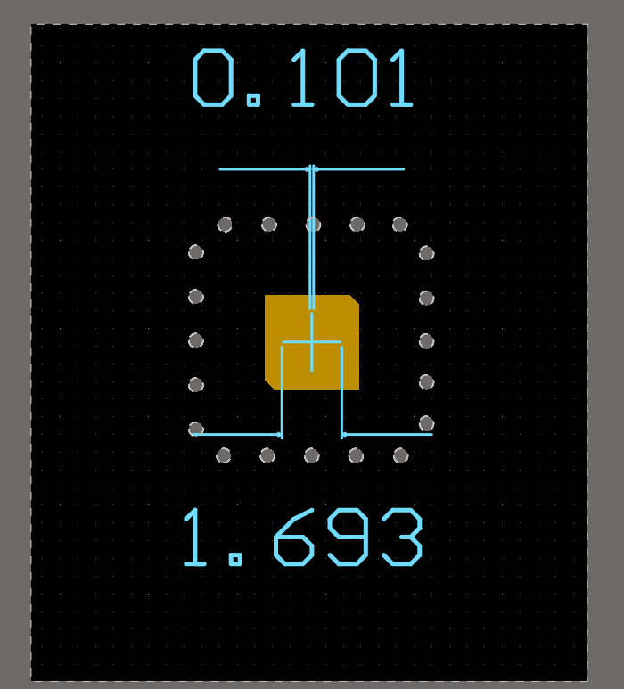
  <br>
  <em>Abb. 17. Geometrie der Kopplungsapertur: Schlitzlänge 1.693 mm, Schlitzbreite 0.101 mm im Perforationsfeld.</em>
</p>

<p align="center">
  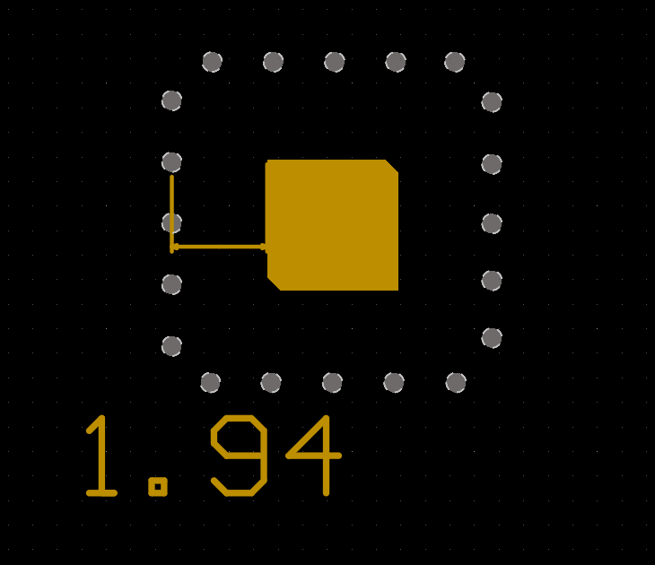
  <br>
  <em>Abb. 18. Lateraler Abstand vom Elementzentrum zur Perforationsreihe: 1.94 mm.</em>
</p>

### 2. Resonator-Neujustierung und Stichleitungs-Verkürzung
Um die durch die Masseleiter-Diskontinuitäten verursachte Blindwiderstandsverschiebung zu kompensieren, wurde der Lambda/Viertel-Transformator (Anpassungsstichleitung) auf eine Länge von $L_t = 1.738$ mm verkürzt (ursprünglich 1.83 mm). Die Resonatorabmessungen wurden angepasst:

Länge des verkürzten Lambda/Viertel-Transformators: $L_t = 1.738$ mm.<br>
Kantenlänge des unteren Hauptstrahlers vergrößert auf 2.668 mm $\times$ 2.668 mm.<br>
Diagonale Eckenabschrägungen des unteren Patches angepasst auf $\Delta c = 0.373$ mm.<br>
Kantenlänge des oberen parasitären Patches auf 2.50 mm $\times$ 2.50 mm optimiert.

<p align="center">
  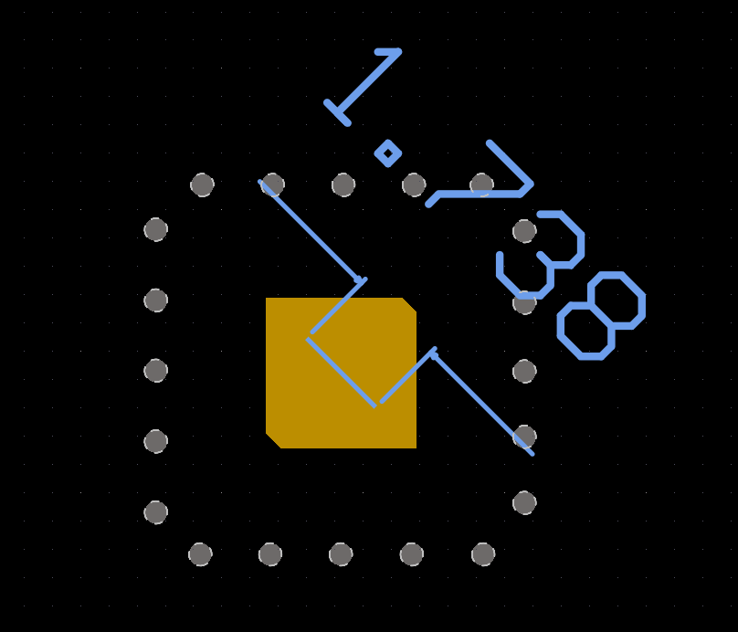
  <br>
  <em>Abb. 19. Länge des verkürzten Lambda/Viertel-Transformators (Stichleitung): 1.738 mm.</em>
</p>

<p align="center">
  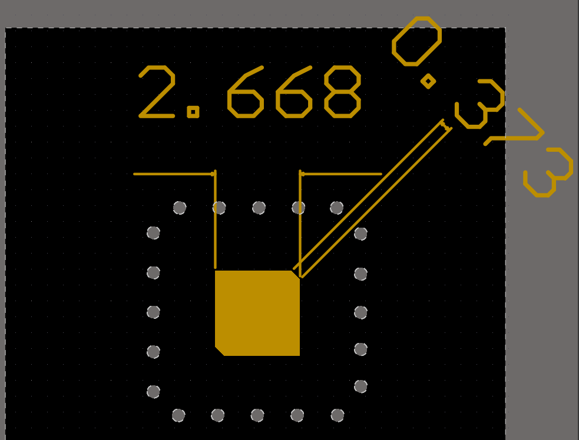
  <br>
  <em>Abb. 20. Layout des nachjustierten Hauptstrahlers: Kantenlänge 2.668 mm, Eckenabschrägung 0.373 mm.</em>
</p>

### 3. Ergebnisse nach der Optimierung

Reflexionsfaktor ($S_{11}$) und Betriebsbandbreite:
Untere Bandgrenze bei $S_{11} = -10$ dB: $f_{\text{low}} = 27.927$ GHz ($S_{11} = -10.06$ dB).<br>
Obere Bandgrenze bei $S_{11} = -10$ dB: $f_{\text{high}} = 29.711$ GHz ($S_{11} = -10.06$ dB).<br>
Die gesamte -10-dB-Anpassungsbandbreite erweiterte sich auf $\Delta f = 1.784$ GHz (Bereich 27.93–29.71 GHz).

Stehwellenverhältnis (VSWR):
Bei 29.0 GHz verbesserte sich das Stehwellenverhältnis auf 1.30 (im Ursprungsentwurf 1.56).<br>
Das Minimum von 1.05 liegt bei 28.7 GHz und gewährleistet hervorragende 50-Ohm-Anpassung.

Wiederherstellung der zirkularen Polarisation (Axial Ratio):
Bei 29.0 GHz verbesserte sich das Achsenverhältnis in Normalenrichtung ($\theta = 0^\circ$) auf 2.8 dB.<br>
Das Achsenverhältnis unterschreitet nun wieder die kritische Grenze von 3.0 dB, was die erfolgreiche Dämpfung parasitärer Oberflächenwellen und die Rückkehr zur zirkularen Polarisation belegt.

<p align="center">
  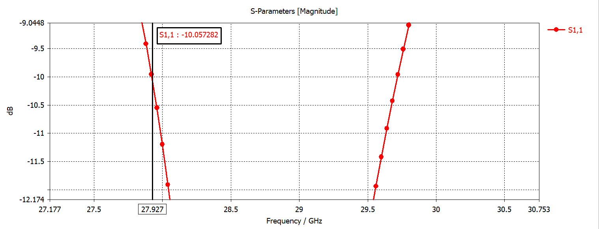
  <br>
  <em>Abb. 21. Untere Grenzfrequenz nach Neujustierung bei S11 = -10 dB (Marker 27.927 GHz, -10.06 dB).</em>
</p>

<p align="center">
  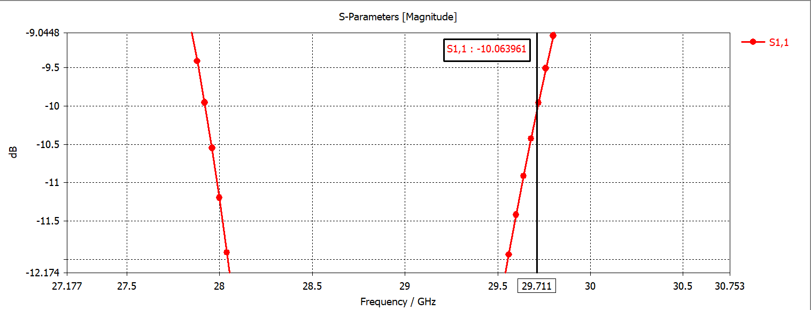
  <br>
  <em>Abb. 22. Obere Grenzfrequenz nach Neujustierung bei S11 = -10 dB (Marker 29.711 GHz, -10.06 dB).</em>
</p>

<p align="center">
  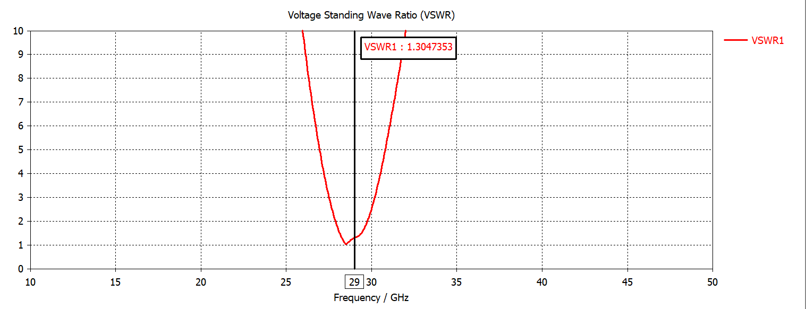
  <br>
  <em>Abb. 23. Frequenzverlauf des VSWR nach Neujustierung (VSWR = 1.30 bei 29.0 GHz).</em>
</p>

<p align="center">
  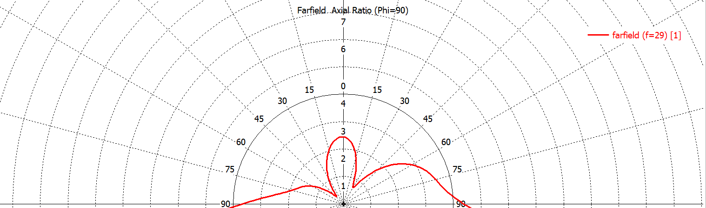
  <br>
  <em>Abb. 24. Polardiagramm des Achsenverhältnisses bei 29 GHz: Wiederherstellung auf 2.8 dB (< 3.0 dB).</em>
</p>

Räumliche Richtcharakteristik und Wirkungsgrad des optimierten Einzelstrahlers:
Der Richtfaktor (Directivity) erreicht 7.47 dBi bei 29.0 GHz.<br>
Der Strahlungswirkungsgrad (Radiation Efficiency) liegt bei 94.7% ($-0.236$ dB).<br>
Der Gesamtwirkungsgrad (Total Efficiency) beträgt 93.1% ($-0.313$ dB).

<p align="center">
  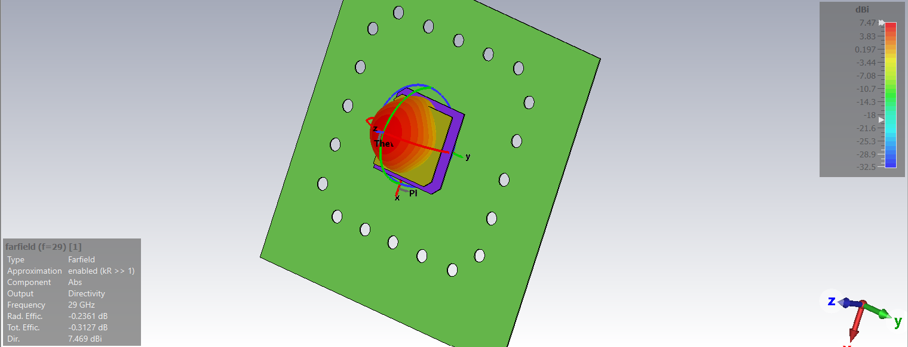
  <br>
  <em>Abb. 25. Räumliches 3D-Fernfeld-Richtdiagramm des optimierten Einzelstrahlers bei 29 GHz (Directivity = 7.47 dBi).</em>
</p>

## 2×2-Teilarray mit sequentieller Phasen- und Raumrotation

Zur fundamentalen Beseitigung der durch Verkopplung und Substrat-Oberflächenwellen verursachten Degradation der zirkularen Polarisation in großen planaren Arrays wurden die optimierten Strahler zu einem $2 \times 2$-Teilarray nach der Sequential Rotation-Methode zusammengefasst.

### 1. Architektur und Aufbau des 2×2-Teilarrays
In der $2 \times 2$-Zelle wird jedes benachbarte Element räumlich um $90^\circ$ entlang der Achse normal zur Apertur gedreht ($0^\circ, 90^\circ, 180^\circ, 270^\circ$). Die Speisephasen der Tore werden mit entsprechenden Quadratur-Phasenverschiebungen angesteuert ($0^\circ, 90^\circ, 180^\circ, 270^\circ$), um ein kohärentes zirkulares Drehfeld zu erzeugen.<br>
Um jedes Einzelelement bleibt der Schutzring aus Masseflächen-Perforationen zur Abschirmung dielektrischer Oberflächenwellen erhalten.

Vorteile der sequentiellen Rotation:
Gegenseitige Auslöschung parasitärer kreuzpolarisierter Raummoden höherer Ordnung.<br>
Kompensation reflektierter Wellen an den Toren des Speisenetzwerks, was die Eingangsanpassung signifikant verbessert.<br>
Drastische Erweiterung der Bandbreite mit hochreiner zirkularer Polarisation ($\text{AR} < 3$ dB).

<p align="center">
  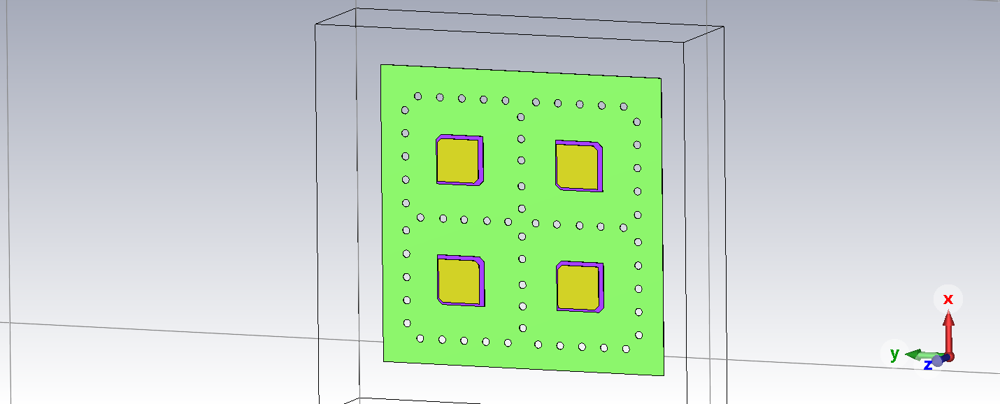
  <br>
  <em>Abb. 26. 3D-Topologie des 2x2-Teilarrays: sequentielle 90°-Raumdrehung der Elemente und Masseleiter-Perforationsbarrieren.</em>
</p>

### 2. Port-Anpassung des 2×2-Teilarrays
Die Stehwellenverhältnisse (VSWR) an allen vier unabhängigen Toren (VSWR1, VSWR2, VSWR3, VSWR4) weisen eine hohe Symmetrie und hervorragende Anpassung auf:

Die Resonanzminima an den Toren erreichen Werte zwischen 1.05 und 1.22 im Frequenzintervall 29.1–29.4 GHz.<br>
Die breitbandige Anpassung gemäß $\text{VSWR} < 2.0$ überstreicht bei allen vier Kanälen den Bereich von 28.4 bis 30.0 GHz.

<p align="center">
  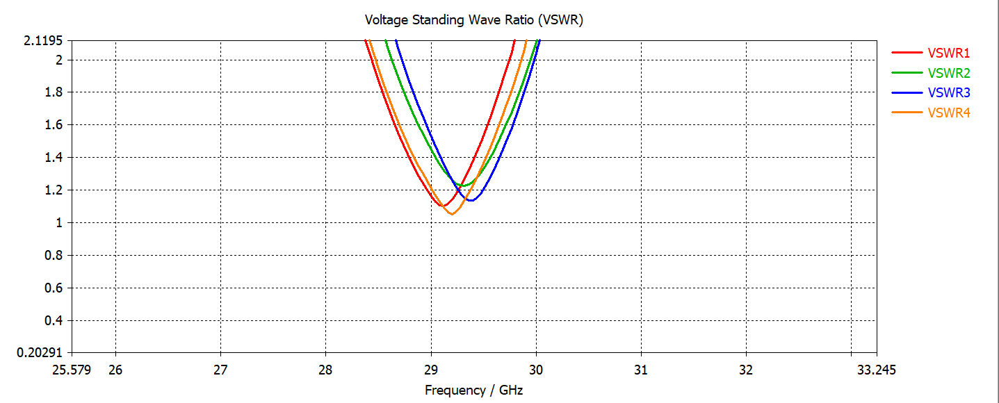
  <br>
  <em>Abb. 27. VSWR-Frequenzverläufe an allen Toren des 2x2-Teilarrays (Minima 1.05–1.22).</em>
</p>

### 3. Abstrahl- und Gewinncharakteristik
Bei Superposition der vier Kanäle mit sequentieller Phasenbelegung $[1\angle 0^\circ, 1\angle 90^\circ, 1\angle 180^\circ, 1\angle 270^\circ]$:

Der Antennengewinn (Realized Gain) bei 29.0 GHz erreicht 10.60 dBi.<br>
Der Strahlungswirkungsgrad beträgt 94.2% ($-0.259$ dB).<br>
Der Gesamtwirkungsgrad liegt bei 91.4% ($-0.391$ dB).<br>
Das Richtdiagramm bildet eine rotationssymmetrische Hauptkeule mit hoher Polarisationstreue.

<p align="center">
  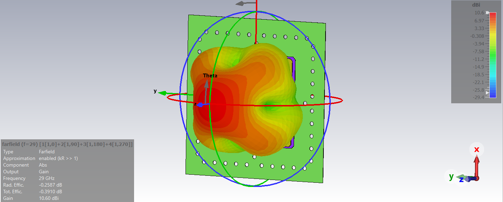
  <br>
  <em>Abb. 28. Räumliches 3D-Gewinndiagramm des 2x2-Teilarrays bei 29 GHz (Gain = 10.60 dBi).</em>
</p>

### 4. Wesentliche Verbesserung der zirkularen Polarisation (Axial Ratio)
Die sequentielle Phasen- und Raumrotation beseitigt die Polarisationsdegradation im Array vollständig und liefert hervorragende Achsenverhältnisse im gesamten Frequenzband:

Bei 28.0 GHz: Das Achsenverhältnis in Normalenrichtung ($\theta = 0^\circ$) sinkt auf bemerkenswerte 0.8 dB (im unkompensierten 8x8-Array lag der Wert bei 5.3 dB). Der Winkelbereich mit $\text{AR} < 3$ dB umfasst $|\theta| \le 22^\circ$.<br>
Bei 29.0 GHz: Das axiale Verhältnis im Zenit beträgt 1.8 dB mit einem weiten 3-dB-Winkelbereich von $|\theta| \le 18^\circ$.<br>
Bei 30.0 GHz: Das axiale Verhältnis im Zenit liegt bei 1.6 dB (während im regulären 8x8-Array der Bereich auf $< 2^\circ$ kollabierte), mit einem stabilen Polarisationssektor von $|\theta| \le 25^\circ$.

<p align="center">
  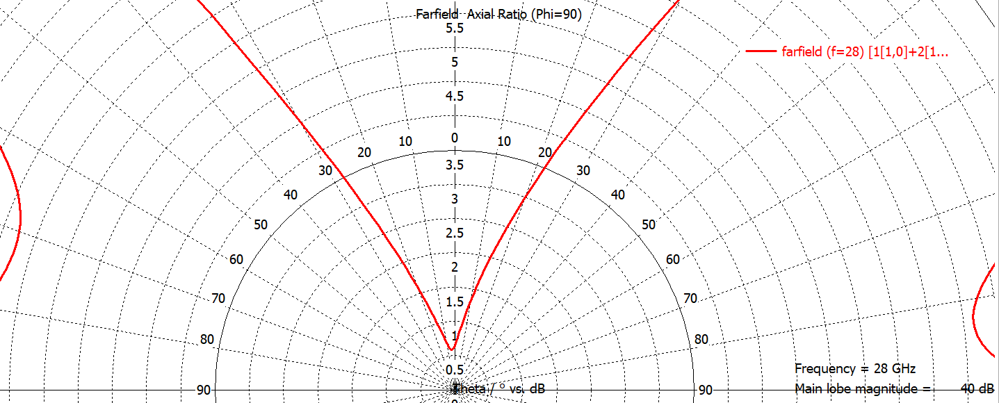
  <br>
  <em>Abb. 29. Polardiagramm des Achsenverhältnisses des 2x2-Teilarrays bei 28 GHz (AR im Zenit 0.8 dB).</em>
</p>

<p align="center">
  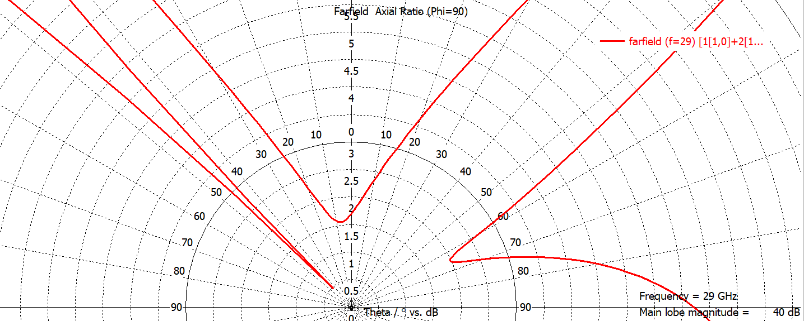
  <br>
  <em>Abb. 30. Polardiagramm des Achsenverhältnisses des 2x2-Teilarrays bei 29 GHz (AR im Zenit 1.8 dB).</em>
</p>

<p align="center">
  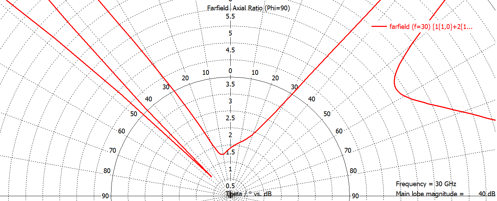
  <br>
  <em>Abb. 31. Polardiagramm des Achsenverhältnisses des 2x2-Teilarrays bei 30 GHz (AR im Zenit 1.6 dB).</em>
</p>

## Lizenz

Copyright (c) 2026 Ilya Kornilov

Dieses Dokument beschreibt Open Hardware und ist unter der CERN-OHL-P v2 lizenziert. 
Sie dürfen diesen Quellcode unter den Bedingungen der CERN-OHL-P v2 (https://cern.ch/cern-ohl) 
weitergeben, modifizieren und Produkte auf dessen Grundlage herstellen.

Dieser Quellcode wird OHNE JEGLICHE AUSDRÜCKLICHE ODER STILLSCHWEIGENDE GEWÄHRLEISTUNG 
vertrieben, EINSCHLIESSLICH DER STILLSCHWEIGENDEN GEWÄHRLEISTUNG DER MARKTGÄNGIGKEIT, 
ZUFRIEDENSTELLENDEN QUALITÄT UND EIGNUNG FÜR EINEN BESTIMMTEN ZWECK. 
Genaue Bestimmungen entnehmen Sie bitte der CERN-OHL-P v2.
