<p align="center">
  <a href="README.md">Русский</a> | <b>English</b> | <a href="README.de.md">Deutsch</a>
</p>

# Broadband Ka-Band (28–30 GHz) Aperture-Coupled Stacked Microstrip Patch Antenna with Circular Polarization

This repository contains the design, analytical synthesis, CAD assets, and full-wave numerical electromagnetic analysis of a broadband Ka-band circularly polarized microstrip patch antenna operating across 28.0–30.0 GHz. The antenna utilizes an aperture-coupled cross-slot feeding technique and a stacked parasitic patch architecture for wideband impedance and axial ratio performance.

## Table of Contents

[Overview](#overview)<br>
[Project Structure](#project-structure)<br>
[Analytical Calculation](#analytical-calculation)<br>
[3D Modeling and Single-Element Optimization](#3d-modeling-and-single-element-optimization)<br>
[Numerical Simulation Results for Single Element](#numerical-simulation-results-for-single-element)<br>
[8x8 Antenna Array Investigation and Surface Wave Effects](#8x8-antenna-array-investigation-and-surface-wave-effects)<br>
[License](#license)

## Overview

The antenna is engineered for broadband Ka-band operations (28.0–30.0 GHz), including mmWave satellite links, wireless front-ends, and radar transceivers.

Key design features:

Topology: Multilayer stacked microstrip patch antenna with parasitic resonance.<br>
Excitation: Non-contact aperture electromagnetic coupling through a cross-slot in the ground plane fed by a microstrip line.<br>
Impedance Matching: Centered open-circuited quarter-wave ($\lambda_g/4$) tuning stub positioned directly over the aperture cross to compensate for slot reactance.<br>
Circular Polarization: Corner-truncated square patch geometry ($45^\circ$ chamfers) on radiating elements generating degenerate orthogonal modes ($TM_{10}$ and $TM_{01}$) in quadrature ($90^\circ$ phase shift).<br>
Bandwidth Expansion: Upper parasitic radiating patch coupled electromagnetically to the driven patch, providing a dual-resonance frequency response over the 28.0–30.0 GHz band.

## Project Structure

The project files are organized as follows:

```
├── .gitignore
├── README.md
├── README.en.md
├── README.de.md
├── cad/
│   ├── antenna_enclosure_base.step            # Antenna housing: lower base enclosure
│   ├── antenna_enclosure_cover.step           # Antenna housing: protective top radome cover
│   ├── antenna_pcb_layout.pcbdoc              # Source PCB layout project (Altium Designer)
│   ├── antenna_pcb_odbpp.zip                  # Manufacturing PCB package in ODB++ format
│   ├── pcb_driven_patch.step                  # 3D STEP model: lower substrate (feed line and driven patch)
│   ├── pcb_parasitic_patch.step               # 3D STEP model: upper substrate (stacked parasitic patch)
│   └── sma_edgemount_connector.step           # 3D STEP model: RF End-Launch SMA connector
├── calculations/
│   └── patch_antenna_analytical_calc.xmcd     # Mathematical derivation and analytical design (Mathcad 14)
├── docs/
│   └── images/
│       ├── array_8x8_3d_directivity_29ghz.png # 3D Directivity pattern of 8x8 array at 29 GHz (21.63 dBi)
│       ├── array_8x8_3d_efield_29ghz.png      # 3D E-field radiation distribution of 8x8 array at 29 GHz
│       ├── array_8x8_axial_ratio_polar_28ghz.png # Polar Axial Ratio cut of 8x8 array at 28 GHz
│       ├── array_8x8_axial_ratio_polar_29ghz.png # Polar Axial Ratio cut of 8x8 array at 29 GHz
│       ├── array_8x8_axial_ratio_polar_30ghz.png # Polar Axial Ratio cut of 8x8 array at 30 GHz
│       ├── array_8x8_gain_polar_29ghz.png     # Polar Gain cut of 8x8 array at 29 GHz (Gain = 21.3 dBi)
│       ├── array_8x8_vswr_ports.png           # Multi-port VSWR characteristics of 8x8 array
│       ├── axial_ratio_3d_pattern_29ghz.png   # 3D Farfield Axial Ratio radiation pattern of single element
│       ├── axial_ratio_polar_29ghz.png        # 2D polar Axial Ratio radiation cut of single element (29 GHz)
│       ├── parasitic_patch_geometry.png       # Geometry of upper stacked parasitic patch
│       ├── patch_truncation_geometry.png      # Geometry of lower driven patch and corner truncations
│       ├── simulation_s11_band_edge_lower.png # Lower -10 dB return loss band edge (27.94 GHz)
│       ├── simulation_s11_band_edge_upper.png # Upper -10 dB return loss band edge (29.58 GHz)
│       ├── simulation_s_parameters_s11.png    # Reflection coefficient S11 frequency response
│       ├── simulation_vswr.png                # Voltage Standing Wave Ratio (VSWR) plot
│       └── simulation_z_parameters.png        # Input impedance Z11 (Real/Imaginary) plot
└── simulation/
    └── cp_stacked_patch_antenna_29ghz.cst     # Full-wave 3D electromagnetic model (CST Studio Suite)
```

## Analytical Calculation

The initial analytical dimensioning was performed in Mathcad ([patch_antenna_analytical_calc.xmcd](calculations/patch_antenna_analytical_calc.xmcd)):

### 1. Substrate Properties
Relative dielectric permittivity: $\varepsilon_r = 2.33$<br>
Substrate thickness: $h = 0.254$ mm (10 mil)<br>
Copper conductor thickness: $t = 35\ \mu\text{m}$ (1 oz Cu)<br>
Frequency specifications: $f_1 = 28.0$ GHz, $f_2 = 30.0$ GHz, center frequency $f_0 = 29.0$ GHz

### 2. Fundamental Patch Dimensions
Theoretical width:
$$W = \frac{c}{2 f_0} \sqrt{\frac{2}{\varepsilon_r + 1}} \approx 4.01\text{ mm}$$
Fringing field edge extension: $\Delta L \approx 0.129$ mm.<br>
Effective resonant length: $L_{\text{eff}} \approx 3.13$ mm.

### 3. Cross-Slot Aperture Geometry
Slot width: $W_{\text{cross}} = 1.0$ mm.<br>
Resonant slot arm length: $L_{1\text{cross}} = L_{2\text{cross}} \approx 1.69$ mm ($\approx \lambda_g / 4$).

### 4. Microstrip Feed Line and Tuning Stub
Quasistatic effective permittivity (Wheeler & Schneider model): $\varepsilon_{\text{eff},0} = 1.961$.<br>
High-frequency dispersion correction (Kobayashi model): $\varepsilon_{\text{eff}}(29\text{ GHz}) = 1.997$.<br>
Conductor thickness correction (Wheeler): $\Delta W_2 \approx 0.215$ mm.<br>
Quarter-wave open stub: stub length $L_t = \lambda_g / 4 \approx 1.83$ mm, guided wavelength $\lambda_g \approx 7.32$ mm, trace width $W_t \approx 0.54$ mm for $Z_0 = 50\ \Omega$.

<p align="center">
  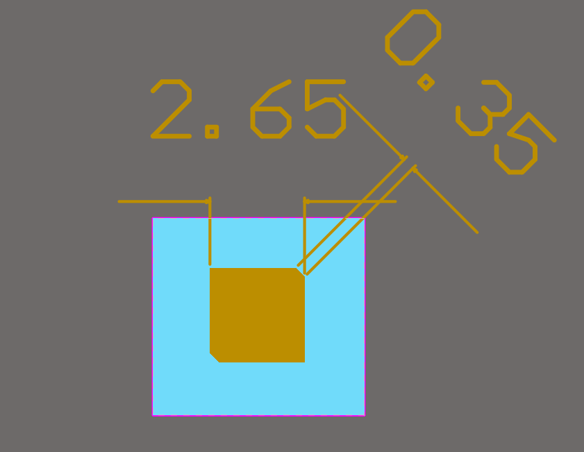
  <br>
  <em>Figure 1. Layout of the lower square patch radiator: patch width 2.65 mm, corner truncation size 0.35 mm.</em>
</p>

## 3D Modeling and Single-Element Optimization

Electromagnetic modeling and parameter optimization were performed in CST Studio Suite ([cp_stacked_patch_antenna_29ghz.cst](simulation/cp_stacked_patch_antenna_29ghz.cst)). The evolutionary design process proceeded through the following systematic phases:

### 1. Initial Single-Patch Baseline
Synthesized the microstrip feed line terminated with an open-circuited quarter-wave stub centered symmetrically over the cross-slot aperture in the ground plane to compensate for slot reactance.

### 2. VSWR Tuning
Parametrically adjusted the primary radiator dimensions to ensure optimal impedance match across the operational frequency band.

### 3. Circular Polarization Generation
Introduced diagonal corner truncations of dimension $\Delta c = 0.35$ mm on the driven square patch (2.65 mm $\times$ 2.65 mm). This geometrical perturbation couples the orthogonal modes with equal magnitudes and a $90^\circ$ relative phase difference.

### 4. Bandwidth Broadening via Stacked Parasitic Patch
Introduced a second dielectric layer of thickness $h_2 = 0.203$ mm supporting a parasitic microstrip element positioned above the driven patch:

The square parasitic patch dimensions are 2.01 mm $\times$ 2.01 mm.<br>
Diagonal corner truncations on the parasitic patch measure $\Delta c_{\text{top}} = 0.29$ mm at $45^\circ$, maintaining circular polarization across both coupled resonant modes.<br>
The coupled multi-resonant system expands the impedance bandwidth ($S_{11} < -10$ dB) and the 3 dB Axial Ratio bandwidth across the 28.0–30.0 GHz band.

<p align="center">
  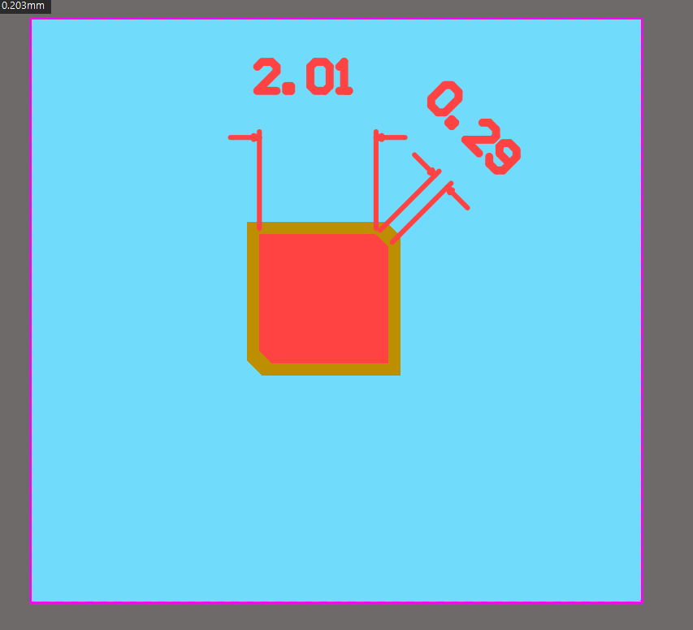
  <br>
  <em>Figure 2. Layout of the upper parasitic radiator: patch width 2.01 mm, corner truncation 0.29 mm, dielectric spacing 0.203 mm.</em>
</p>

<p align="center">
  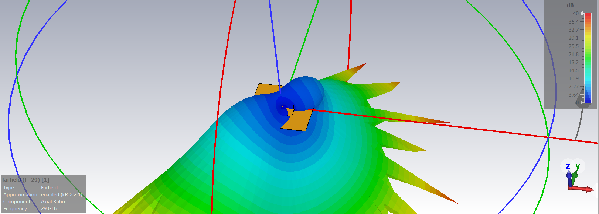
  <br>
  <em>Figure 3. 3D CST single-element model and spatial Axial Ratio radiation distribution.</em>
</p>

## Numerical Simulation Results for Single Element

### 1. Reflection Coefficient ($S_{11}$) and Bandwidth Edges
Across the broadband range of 28.0–30.0 GHz, the antenna maintains strong return loss.<br>
At 29.0 GHz, the return loss evaluates to $S_{11} = -13.24$ dB.<br>
Resonance minima reach $-21.5$ to $-28.0$ dB across the band.

Impedance matching bandwidth limits evaluated at the standard $S_{11} \le -10$ dB threshold:

Lower frequency edge: $f_{\text{low}} = 27.938$ GHz at $S_{11} = -10.28$ dB.<br>
Upper frequency edge: $f_{\text{high}} = 29.576$ GHz at $S_{11} = -10.58$ dB.<br>
Operational -10 dB bandwidth: $\Delta f = 1.638$ GHz (27.94–29.58 GHz band), fully covering the targeted Ka-band channel allocation.

<p align="center">
  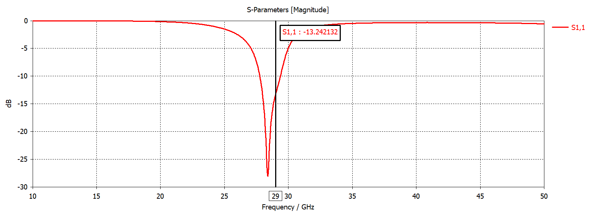
  <br>
  <em>Figure 4. Broadband simulated reflection coefficient S11 versus frequency.</em>
</p>

<p align="center">
  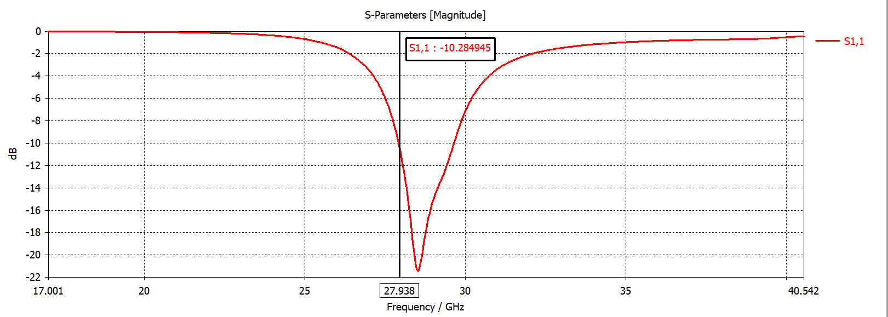
  <br>
  <em>Figure 5. Lower band edge at S11 = -10 dB (marker 27.938 GHz, -10.28 dB).</em>
</p>

<p align="center">
  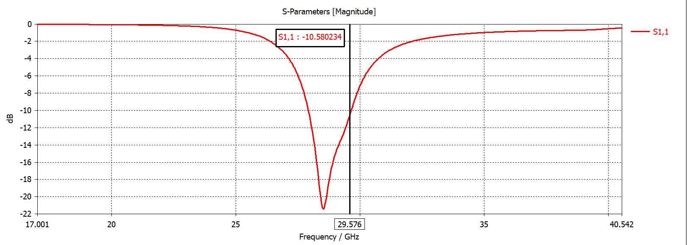
  <br>
  <em>Figure 6. Upper band edge at S11 = -10 dB (marker 29.576 GHz, -10.58 dB).</em>
</p>

### 2. Voltage Standing Wave Ratio (VSWR)
At 29.0 GHz, the VSWR is 1.56. Across the operational band of 27.2–29.8 GHz, the VSWR remains well below 2.0, reaching a minimum of 1.08 in the optimal match zone.

<p align="center">
  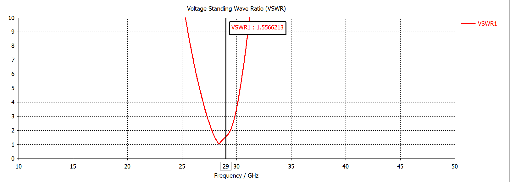
  <br>
  <em>Figure 7. Simulated VSWR versus frequency of single element.</em>
</p>

### 3. Input Impedance ($Z_{11}$)
At 29.0 GHz, the input impedance evaluates to $\mathrm{Re}(Z_{11}) = 32.66\ \Omega$ and $\mathrm{Im}(Z_{11}) = 4.92\ \Omega$. The near-zero reactive component indicates parallel resonance operation of the coupled network.

<p align="center">
  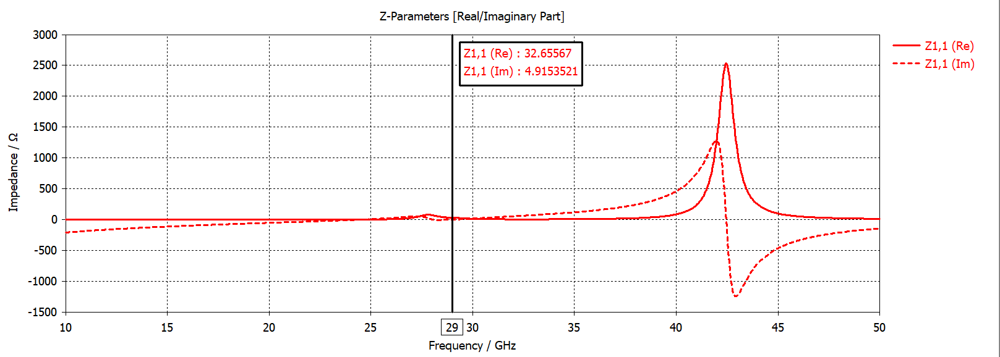
  <br>
  <em>Figure 8. Simulated real and imaginary components of input impedance Z11.</em>
</p>

### 4. Polarization Characteristics (Axial Ratio)
In the broadside direction ($\theta = 0^\circ$) at 29.0 GHz, the axial ratio is approximately 1.0 dB, satisfying the standard circular polarization threshold of 3.0 dB. The axial ratio remains below 3.0 dB across a wide angular beamwidth of $|\theta| \le 30^\circ$.

<p align="center">
  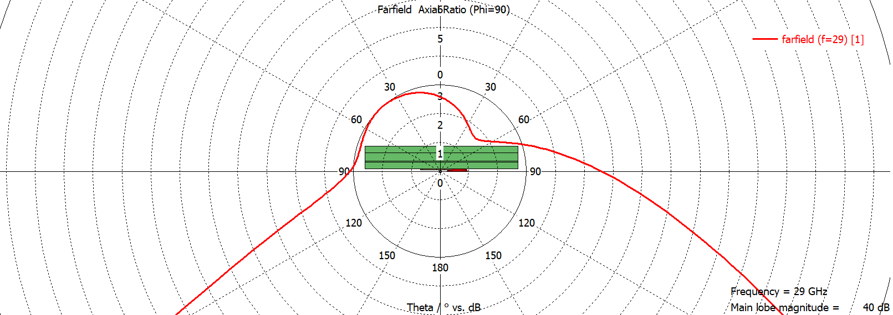
  <br>
  <em>Figure 9. Farfield Axial Ratio polar cut (Phi=90°) of single element at 29 GHz.</em>
</p>

## 8x8 Antenna Array Investigation and Surface Wave Effects

To achieve high directivity and narrow beamwidth, an $8 \times 8$ planar array comprising 64 stacked patch elements was designed and simulated. During the optimization of inter-element spacing intended to maximize gain and steerable angular coverage, the physical mechanism of substrate surface waves and mutual coupling emerged as a primary design challenge.

### 1. Radiation Characteristics of the 8x8 Array
At 29.0 GHz, the array forms a high-gain pencil beam along the broadside direction:

Directivity: 21.63 dBi at broadside ($\theta = 0^\circ$).<br>
Realized Gain: 21.3 dBi in the $\Phi = 90^\circ$ principal plane.<br>
Half-Power Beamwidth (HPBW, 3 dB): $9.6^\circ$.<br>
Side Lobe Level (SLL): $-10.0$ dB.<br>
Radiation Efficiency: 92.9% ($-0.32$ dB), Total Efficiency: 85.6% ($-0.68$ dB).<br>
Peak Farfield Electric Field: $E_{\max} = 408.6$ V/m at $r = 1$ m.

<p align="center">
  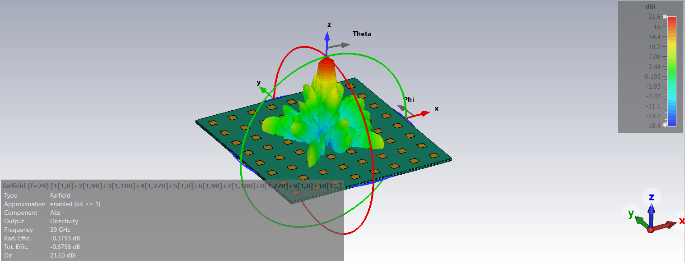
  <br>
  <em>Figure 10. 3D farfield directivity pattern of the 8x8 array at 29 GHz (peak 21.63 dBi).</em>
</p>

<p align="center">
  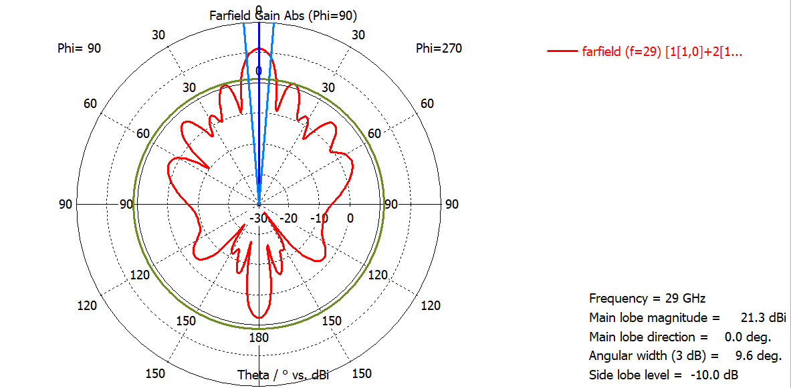
  <br>
  <em>Figure 11. Polar gain pattern of the 8x8 array in the Phi=90° plane (Gain = 21.3 dBi, HPBW = 9.6°).</em>
</p>

<p align="center">
  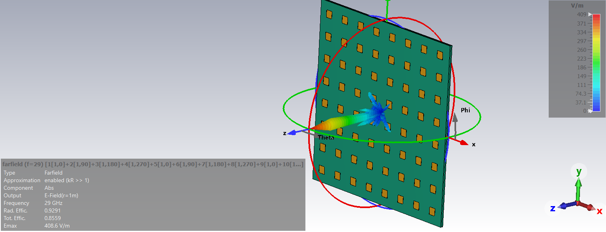
  <br>
  <em>Figure 12. 3D E-field radiation distribution of the 8x8 array at 29 GHz.</em>
</p>

### 2. Mutual Coupling and Resonance Dispersal Across Array Ports (VSWR)
Guided surface waves excited within the continuous dielectric substrate cause strong electromagnetic coupling among neighboring elements. Due to position asymmetry (inner, edge, and corner radiators experience distinctly different mutual environments), each array port exhibits a shifted active impedance:

Individual port resonances disperse across 28.5–29.8 GHz.<br>
While VSWR remains within acceptable limits (1.1 to 1.7 at resonant dips), the resonance curves bifurcate across the multi-element network.

<p align="center">
  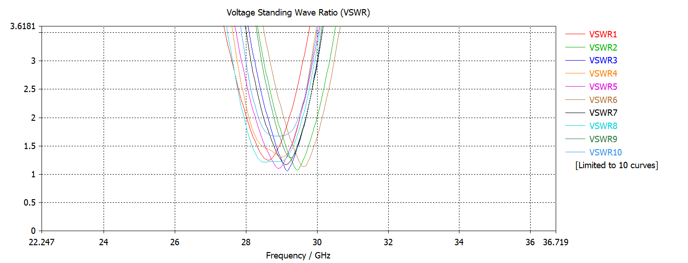
  <br>
  <em>Figure 13. Simulated VSWR curves across 8x8 array ports illustrating resonance dispersal due to mutual coupling.</em>
</p>

### 3. Circular Polarization Degradation Due to Surface Waves
The critical consequence of substrate surface waves is the disruption of the circular polarization balance:

Circular polarization in the isolated element relied on precise amplitude equality and a $90^\circ$ phase difference between the two orthogonal modes.<br>
Within the $8 \times 8$ array, surface wave mutual fields induce secondary currents with non-quadrature phase shifts across adjacent radiators.<br>
Consequently, the axial ratio deteriorates across the operational band:

At 28.0 GHz, broadside axial ratio degrades to 5.3 dB, indicating a transition from circular to elliptical polarization.<br>
At 29.0 GHz, broadside axial ratio degrades to 3.9 dB, exceeding the standard 3.0 dB circular polarization criterion.<br>
At 30.0 GHz, the broadside axial ratio remains at 2.6 dB only within an extremely narrow angular range ($< 2^\circ$), deteriorating rapidly off-axis.

<p align="center">
  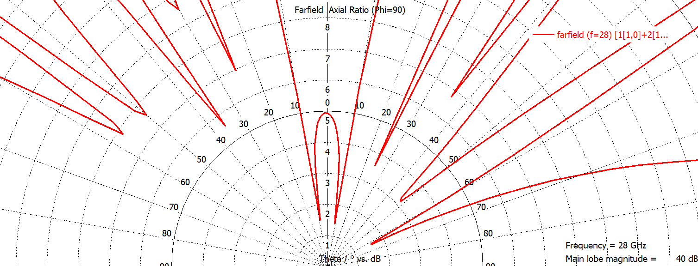
  <br>
  <em>Figure 14. Polar Axial Ratio cut of the 8x8 array at 28 GHz (degradation to 5.3 dB).</em>
</p>

<p align="center">
  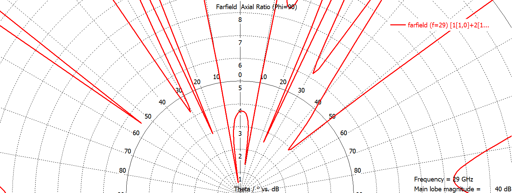
  <br>
  <em>Figure 15. Polar Axial Ratio cut of the 8x8 array at 29 GHz (degradation to 3.9 dB).</em>
</p>

<p align="center">
  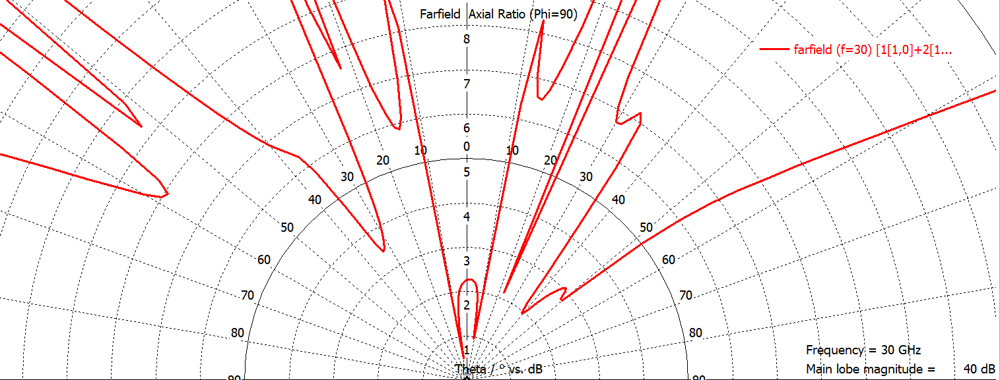
  <br>
  <em>Figure 16. Polar Axial Ratio cut of the 8x8 array at 30 GHz.</em>
</p>

These findings illustrate that suppressing dielectric surface waves (e.g., through electromagnetic bandgap / EBG structures, substrate decoupling slots, or segmented dielectric islands) is mandatory for maintaining high-purity circular polarization in large-scale mmWave planar arrays.

## License

Copyright (c) 2026 Ilya Kornilov

This source describes Open Hardware and is licensed under the CERN-OHL-P v2. 
You may redistribute and modify this source and make products using it under 
the terms of the CERN-OHL-P v2 (https://cern.ch/cern-ohl).

This source is distributed WITHOUT ANY EXPRESS OR IMPLIED WARRANTY, 
INCLUDING OF MERCHANTABILITY, SATISFACTORY QUALITY AND FITNESS FOR A 
PARTICULAR PURPOSE. Please see the CERN-OHL-P v2 for applicable conditions.
