<p align="center">
  <a href="README.md">Русский</a> | <b>English</b> | <a href="README.de.md">Deutsch</a>
</p>

# Broadband Ka-Band (28–30 GHz) Aperture-Coupled Stacked Microstrip Patch Antenna with Circular Polarization

This repository contains the design, analytical synthesis, CAD assets, and full-wave numerical electromagnetic analysis of a broadband Ka-band circularly polarized microstrip patch antenna operating across 28.0–30.0 GHz. The antenna utilizes an aperture-coupled cross-slot feeding technique and a stacked parasitic patch architecture for wideband impedance and axial ratio performance.

## Table of Contents

[Overview](#overview)<br>
[Project Structure](#project-structure)<br>
[Analytical Calculation](#analytical-calculation)<br>
[3D Modeling and Single-Element Optimization](#3d-modeling-and-single-element-optimization)<br>
[Numerical Simulation Results for Single Element](#numerical-simulation-results-for-single-element)<br>
[8x8 Antenna Array Investigation and Surface Wave Effects](#8x8-antenna-array-investigation-and-surface-wave-effects)<br>
[Surface Wave Suppression via Ground Plane Perforations and Element Retuning](#surface-wave-suppression-via-ground-plane-perforations-and-element-retuning)<br>
[2×2 Sequentially Rotated Sub-Array Architecture](#22-sequentially-rotated-sub-array-architecture)<br>
[Final Optimized 8×8 Array Integration and Phased Beam Steering](#final-optimized-88-array-integration-and-phased-beam-steering)<br>
[License](#license)

## Overview

The antenna is engineered for broadband Ka-band operations (28.0–30.0 GHz), including mmWave satellite links, wireless front-ends, and radar transceivers.

Key design features:

Topology: Multilayer stacked microstrip patch antenna with parasitic resonance.<br>
Excitation: Non-contact aperture electromagnetic coupling through a cross-slot in the ground plane fed by a microstrip line.<br>
Impedance Matching: Centered open-circuited quarter-wave ($\lambda_g/4$) tuning stub positioned directly over the aperture cross to compensate for slot reactance.<br>
Circular Polarization: Corner-truncated square patch geometry ($45^\circ$ chamfers) on radiating elements generating degenerate orthogonal modes ($TM_{10}$ and $TM_{01}$) in quadrature ($90^\circ$ phase shift).<br>
Bandwidth Expansion: Upper parasitic radiating patch coupled electromagnetically to the driven patch, providing a dual-resonance frequency response over the 28.0–30.0 GHz band.<br>
Surface Wave Mitigation: Ground plane perforations encircling radiators to generate discontinuities that reflect substrate surface waves and mitigate inter-element mutual coupling.<br>
Ultra-Wideband CP Array Performance: $2 \times 2$ sequential rotation sub-array topology ($0^\circ, 90^\circ, 180^\circ, 270^\circ$) providing mutual cancellation of cross-polarized fields and exceptional axial ratio bandwidth.<br>
Material Stackup and Substrate: Low-loss Rogers RT/duroid 5870 ($h = 0.254$ mm, $\varepsilon_r = 2.33$, $\tan\delta = 0.0012$) with 35 $\mu$m copper (1 oz), board size 90 $\times$ 89 mm with broad ground margins preventing edge element VSWR degradation.<br>
RF Isolation and Shielding: Aperture coupling through continuous ground plane provides robust isolation between radiating apertures and backside beamforming ICs (RFICs).

## Project Structure

The project files are organized as follows:

```
├── .gitignore
├── README.md
├── README.en.md
├── README.de.md
├── cad/
│   ├── antenna_enclosure_base.step            # Antenna housing: lower base enclosure
│   ├── antenna_enclosure_cover.step           # Antenna housing: protective top radome cover
│   ├── antenna_pcb_layout.pcbdoc              # Source PCB layout project (Altium Designer)
│   ├── antenna_pcb_odbpp.zip                  # Manufacturing PCB package in ODB++ format
│   ├── pcb_driven_patch.step                  # 3D STEP model: lower substrate (feed line and driven patch)
│   ├── pcb_parasitic_patch.step               # 3D STEP model: upper substrate (stacked parasitic patch)
│   └── sma_edgemount_connector.step           # 3D STEP model: RF End-Launch SMA connector
├── calculations/
│   └── patch_antenna_analytical_calc.xmcd     # Mathematical derivation and analytical design (Mathcad 14)
├── docs/
│   └── images/
│       ├── antenna_stackup_exploded_view.jpg  # Exploded view diagram of antenna PCB stackup
│       ├── array_8x8_3d_directivity_29ghz.png # 3D Directivity pattern of 8x8 array at 29 GHz (21.63 dBi)
│       ├── array_8x8_3d_efield_29ghz.png      # 3D E-field radiation distribution of 8x8 array at 29 GHz
│       ├── array_8x8_3d_steered_beam_0deg.png # 3D beam pattern of 8x8 array steered to 0° (boresight)
│       ├── array_8x8_3d_steered_beam_17deg.png # 3D beam pattern of 8x8 array steered to 17°
│       ├── array_8x8_3d_steered_beam_33deg.png # 3D beam pattern of 8x8 array steered to 33°
│       ├── array_8x8_axial_ratio_polar_28ghz.png # Polar Axial Ratio cut of 8x8 array at 28 GHz
│       ├── array_8x8_axial_ratio_polar_29ghz.png # Polar Axial Ratio cut of 8x8 array at 29 GHz
│       ├── array_8x8_axial_ratio_polar_30ghz.png # Polar Axial Ratio cut of 8x8 array at 30 GHz
│       ├── array_8x8_dimensions_and_ground_margin.png # PCB layout 90x89 mm with broad ground margins
│       ├── array_8x8_final_3d_efield_29ghz.png # 3D E-field distribution of final 8x8 array at 29 GHz
│       ├── array_8x8_final_axial_ratio_polar_28ghz.png # Axial Ratio of final 8x8 array at 28 GHz (2.1 dB)
│       ├── array_8x8_final_axial_ratio_polar_29ghz.png # Axial Ratio of final 8x8 array at 29 GHz (1.6 dB)
│       ├── array_8x8_final_axial_ratio_polar_30ghz.png # Axial Ratio of final 8x8 array at 30 GHz (0.7 dB)
│       ├── array_8x8_final_gain_polar_29ghz.png # Realized Gain of final 8x8 array at 29 GHz (21.8 dBi)
│       ├── array_8x8_final_model_ports.png    # 3D model of final 8x8 array with 64 ports in CST
│       ├── array_8x8_final_vswr_ports.png     # VSWR characteristics across ports of final 8x8 array
│       ├── array_8x8_gain_polar_29ghz.png     # Polar Gain cut of 8x8 array at 29 GHz (Gain = 21.3 dBi)
│       ├── array_8x8_steered_axial_ratio_0deg.png # Axial Ratio polar cut steered to boresight (0°)
│       ├── array_8x8_steered_axial_ratio_17deg.png # Axial Ratio polar cut steered to 17°
│       ├── array_8x8_steered_axial_ratio_33deg.png # Axial Ratio polar cut steered to 33°
│       ├── array_8x8_steered_beam_0deg.png    # Polar E-field pattern steered to boresight (0°)
│       ├── array_8x8_steered_beam_17deg.png   # Polar E-field pattern steered to 17°
│       ├── array_8x8_steered_beam_33deg.png   # Polar E-field pattern steered to 33°
│       ├── array_8x8_vswr_ports.png           # Multi-port VSWR characteristics of 8x8 array
│       ├── axial_ratio_3d_pattern_29ghz.png   # 3D Farfield Axial Ratio radiation pattern of single element
│       ├── axial_ratio_polar_29ghz.png        # 2D polar Axial Ratio radiation cut of single element (29 GHz)
│       ├── cross_slot_aperture_dimensions.png # Dimensions of coupling cross-slot aperture (1.693 mm x 0.101 mm)
│       ├── ground_holes_lateral_spacing.png   # Lateral spacing to ground plane holes (1.94 mm)
│       ├── parasitic_patch_geometry.png       # Initial upper parasitic patch dimensions (2.01 mm)
│       ├── patch_truncation_geometry.png      # Initial lower driven patch dimensions (2.65 mm)
│       ├── retuned_axial_ratio_polar_29ghz.png # Retuned Axial Ratio polar cut (2.8 dB at 29 GHz)
│       ├── retuned_driven_patch_with_ground_holes.png # Retuned driven patch dimensions (2.668 mm)
│       ├── retuned_quarter_wave_transformer.png # Retuned quarter-wave transformer length (1.738 mm)
│       ├── retuned_s11_band_edge_lower.png    # Retuned lower return loss band edge (27.927 GHz)
│       ├── retuned_s11_band_edge_upper.png    # Retuned upper return loss band edge (29.711 GHz)
│       ├── retuned_single_patch_3d_directivity_29ghz.png # 3D directivity of retuned patch (7.47 dBi)
│       ├── retuned_vswr.png                   # Retuned VSWR response (1.30 at 29.0 GHz)
│       ├── simulation_s11_band_edge_lower.png # Initial lower -10 dB return loss band edge (27.94 GHz)
│       ├── simulation_s11_band_edge_upper.png # Initial upper -10 dB return loss band edge (29.58 GHz)
│       ├── simulation_s_parameters_s11.png    # Initial reflection coefficient S11 frequency response
│       ├── simulation_vswr.png                # Initial VSWR plot of single element
│       ├── simulation_z_parameters.png        # Initial input impedance Z11 plot
│       ├── subarray_2x2_3d_gain_29ghz.png     # 3D Gain pattern of 2x2 sub-array (10.60 dBi)
│       ├── subarray_2x2_axial_ratio_polar_28ghz.png # Axial Ratio cut of 2x2 sub-array at 28 GHz (0.8 dB)
│       ├── subarray_2x2_axial_ratio_polar_29ghz.png # Axial Ratio cut of 2x2 sub-array at 29 GHz (1.8 dB)
│       ├── subarray_2x2_axial_ratio_polar_30ghz.png # Axial Ratio cut of 2x2 sub-array at 30 GHz (1.6 dB)
│       ├── subarray_2x2_sequential_rotation_geometry.png # 2x2 sub-array 90° rotation geometry
│       └── subarray_2x2_vswr_ports.png        # Port VSWR curves of 2x2 sub-array
├── simulation/
│   ├── cp_stacked_patch_antenna_29ghz.cst     # Full-wave 3D electromagnetic model of single element (CST Studio Suite)
│   └── ka_band_patch_array_8x8_full_model.cst # Full-wave 3D simulation model of final 8x8 array (CST Studio Suite)
```

## Analytical Calculation

The initial analytical dimensioning was performed in Mathcad ([patch_antenna_analytical_calc.xmcd](calculations/patch_antenna_analytical_calc.xmcd)):

### 1. Substrate Properties and Stackup
Substrate material: Rogers RT/duroid 5870 glass microfiber reinforced PTFE.<br>
Relative dielectric permittivity: $\varepsilon_r = 2.33$, loss tangent $\tan\delta = 0.0012$.<br>
Dielectric layer thickness: $h = 0.254$ mm (10 mil).<br>
Copper foil thickness: $t = 35\ \mu\text{m}$ (1 oz electrodeposited copper).<br>
Frequency specifications: $f_1 = 28.0$ GHz, $f_2 = 30.0$ GHz, center frequency $f_0 = 29.0$ GHz.

### 2. Fundamental Patch Dimensions
Theoretical width:
$$W = \frac{c}{2 f_0} \sqrt{\frac{2}{\varepsilon_r + 1}} \approx 4.01\text{ mm}$$
Fringing field edge extension: $\Delta L \approx 0.129$ mm.<br>
Effective resonant length: $L_{\text{eff}} \approx 3.13$ mm.

### 3. Cross-Slot Aperture Geometry
Slot width: $W_{\text{cross}} = 1.0$ mm.<br>
Resonant slot arm length: $L_{1\text{cross}} = L_{2\text{cross}} \approx 1.69$ mm ($\approx \lambda_g / 4$).

### 4. Microstrip Feed Line and Tuning Stub
Quasistatic effective permittivity (Wheeler & Schneider model): $\varepsilon_{\text{eff},0} = 1.961$.<br>
High-frequency dispersion correction (Kobayashi model): $\varepsilon_{\text{eff}}(29\text{ GHz}) = 1.997$.<br>
Conductor thickness correction (Wheeler): $\Delta W_2 \approx 0.215$ mm.<br>
Quarter-wave open stub: stub length $L_t = \lambda_g / 4 \approx 1.83$ mm, guided wavelength $\lambda_g \approx 7.32$ mm, trace width $W_t \approx 0.54$ mm for $Z_0 = 50\ \Omega$.

<p align="center">
  
  <br>
  <em>Figure 1. Layout of the initial lower square patch radiator: patch width 2.65 mm, corner truncation size 0.35 mm.</em>
</p>

## 3D Modeling and Single-Element Optimization

Electromagnetic modeling and parameter optimization were performed in CST Studio Suite ([cp_stacked_patch_antenna_29ghz.cst](simulation/cp_stacked_patch_antenna_29ghz.cst)). The evolutionary design process proceeded through the following systematic phases:

### 1. Initial Single-Patch Baseline
Synthesized the microstrip feed line terminated with an open-circuited quarter-wave stub centered symmetrically over the cross-slot aperture in the ground plane to compensate for slot reactance.

### 2. VSWR Tuning
Parametrically adjusted the primary radiator dimensions to ensure optimal impedance match across the operational frequency band.

### 3. Circular Polarization Generation
Introduced diagonal corner truncations of dimension $\Delta c = 0.35$ mm on the driven square patch (2.65 mm $\times$ 2.65 mm). This geometrical perturbation couples the orthogonal modes with equal magnitudes and a $90^\circ$ relative phase difference.

### 4. Bandwidth Broadening via Stacked Parasitic Patch
Introduced a second dielectric layer of thickness $h_2 = 0.203$ mm supporting a parasitic microstrip element positioned above the driven patch:

The square parasitic patch dimensions are 2.01 mm $\times$ 2.01 mm.<br>
Diagonal corner truncations on the parasitic patch measure $\Delta c_{\text{top}} = 0.29$ mm at $45^\circ$, maintaining circular polarization across both coupled resonant modes.<br>
The coupled multi-resonant system expands the impedance bandwidth ($S_{11} < -10$ dB) and the 3 dB Axial Ratio bandwidth across the 28.0–30.0 GHz band.

<p align="center">
  
  <br>
  <em>Figure 2. Layout of the initial upper parasitic radiator: patch width 2.01 mm, corner truncation 0.29 mm, dielectric spacing 0.203 mm.</em>
</p>

<p align="center">
  
  <br>
  <em>Figure 3. 3D CST single-element model and spatial Axial Ratio radiation distribution.</em>
</p>

## Numerical Simulation Results for Single Element

### 1. Reflection Coefficient ($S_{11}$) and Bandwidth Edges
Across the broadband range of 28.0–30.0 GHz, the antenna maintains strong return loss.<br>
At 29.0 GHz, the return loss evaluates to $S_{11} = -13.24$ dB.<br>
Resonance minima reach $-21.5$ to $-28.0$ dB across the band.

Initial impedance matching bandwidth limits evaluated at the standard $S_{11} \le -10$ dB threshold:

Lower frequency edge: $f_{\text{low}} = 27.938$ GHz at $S_{11} = -10.28$ dB.<br>
Upper frequency edge: $f_{\text{high}} = 29.576$ GHz at $S_{11} = -10.58$ dB.<br>
Operational -10 dB bandwidth: $\Delta f = 1.638$ GHz (27.94–29.58 GHz band).

<p align="center">
  
  <br>
  <em>Figure 4. Broadband simulated reflection coefficient S11 versus frequency.</em>
</p>

<p align="center">
  
  <br>
  <em>Figure 5. Lower band edge at S11 = -10 dB (marker 27.938 GHz, -10.28 dB).</em>
</p>

<p align="center">
  
  <br>
  <em>Figure 6. Upper band edge at S11 = -10 dB (marker 29.576 GHz, -10.58 dB).</em>
</p>

### 2. Voltage Standing Wave Ratio (VSWR)
At 29.0 GHz, the VSWR is 1.56. Across the operational band of 27.2–29.8 GHz, the VSWR remains well below 2.0, reaching a minimum of 1.08 in the optimal match zone.

<p align="center">
  
  <br>
  <em>Figure 7. Simulated VSWR versus frequency of single element.</em>
</p>

### 3. Input Impedance ($Z_{11}$)
At 29.0 GHz, the input impedance evaluates to $\mathrm{Re}(Z_{11}) = 32.66\ \Omega$ and $\mathrm{Im}(Z_{11}) = 4.92\ \Omega$. The near-zero reactive component indicates parallel resonance operation of the coupled network.

<p align="center">
  
  <br>
  <em>Figure 8. Simulated real and imaginary components of input impedance Z11.</em>
</p>

### 4. Polarization Characteristics (Axial Ratio)
In the broadside direction ($\theta = 0^\circ$) at 29.0 GHz, the axial ratio is approximately 1.0 dB, satisfying the standard circular polarization threshold of 3.0 dB. The axial ratio remains below 3.0 dB across a wide angular beamwidth of $|\theta| \le 30^\circ$.

<p align="center">
  
  <br>
  <em>Figure 9. Farfield Axial Ratio polar cut (Phi=90°) of single element at 29 GHz.</em>
</p>

## 8x8 Antenna Array Investigation and Surface Wave Effects

To achieve high directivity and narrow beamwidth, an $8 \times 8$ planar array comprising 64 stacked patch elements was designed and simulated. During the optimization of inter-element spacing intended to maximize gain and steerable angular coverage, the physical mechanism of substrate surface waves and mutual coupling emerged as a primary design challenge.

### 1. Radiation Characteristics of the 8x8 Array
At 29.0 GHz, the array forms a high-gain pencil beam along the broadside direction:

Directivity: 21.63 dBi at broadside ($\theta = 0^\circ$).<br>
Realized Gain: 21.3 dBi in the $\Phi = 90^\circ$ principal plane.<br>
Half-Power Beamwidth (HPBW, 3 dB): $9.6^\circ$.<br>
Side Lobe Level (SLL): $-10.0$ dB.<br>
Radiation Efficiency: 92.9% ($-0.32$ dB), Total Efficiency: 85.6% ($-0.68$ dB).<br>
Peak Farfield Electric Field: $E_{\max} = 408.6$ V/m at $r = 1$ m.

<p align="center">
  
  <br>
  <em>Figure 10. 3D farfield directivity pattern of the 8x8 array at 29 GHz (peak 21.63 dBi).</em>
</p>

<p align="center">
  
  <br>
  <em>Figure 11. Polar gain pattern of the 8x8 array in the Phi=90° plane (Gain = 21.3 dBi, HPBW = 9.6°).</em>
</p>

<p align="center">
  
  <br>
  <em>Figure 12. 3D E-field radiation distribution of the 8x8 array at 29 GHz.</em>
</p>

### 2. Mutual Coupling and Resonance Dispersal Across Array Ports (VSWR)
Guided surface waves excited within the continuous dielectric substrate cause strong electromagnetic coupling among neighboring elements. Due to position asymmetry (inner, edge, and corner radiators experience distinctly different mutual environments), each array port exhibits a shifted active impedance:

Individual port resonances disperse across 28.5–29.8 GHz.<br>
While VSWR remains within acceptable limits (1.1 to 1.7 at resonant dips), the resonance curves bifurcate across the multi-element network.

<p align="center">
  
  <br>
  <em>Figure 13. Simulated VSWR curves across 8x8 array ports illustrating resonance dispersal due to mutual coupling.</em>
</p>

### 3. Circular Polarization Degradation Due to Surface Waves
The critical consequence of substrate surface waves is the disruption of the circular polarization balance:

Circular polarization in the isolated element relied on precise amplitude equality and a $90^\circ$ phase difference between the two orthogonal modes.<br>
Within the $8 \times 8$ array, surface wave mutual fields induce secondary currents with non-quadrature phase shifts across adjacent radiators.<br>
Consequently, the axial ratio deteriorates across the operational band:

At 28.0 GHz, broadside axial ratio degrades to 5.3 dB, indicating a transition from circular to elliptical polarization.<br>
At 29.0 GHz, broadside axial ratio degrades to 3.9 dB, exceeding the standard 3.0 dB circular polarization criterion.<br>
At 30.0 GHz, the broadside axial ratio remains at 2.6 dB only within an extremely narrow angular range ($< 2^\circ$), deteriorating rapidly off-axis.

<p align="center">
  
  <br>
  <em>Figure 14. Polar Axial Ratio cut of the 8x8 array at 28 GHz (degradation to 5.3 dB).</em>
</p>

<p align="center">
  
  <br>
  <em>Figure 15. Polar Axial Ratio cut of the 8x8 array at 29 GHz (degradation to 3.9 dB).</em>
</p>

<p align="center">
  
  <br>
  <em>Figure 16. Polar Axial Ratio cut of the 8x8 array at 30 GHz.</em>
</p>

## Surface Wave Suppression via Ground Plane Perforations and Element Retuning

To attenuate parasitic mutual coupling between adjacent radiating elements, artificial electromagnetic discontinuities were implemented by perforating the ground plane surrounding each radiating unit. The ground plane holes form an electromagnetic barrier that scatters and reflects guided substrate surface waves.

Because the introduction of ground plane perforations altered the local electromagnetic boundary conditions and slot reactive admittance, a systematic retuning of the antenna radiators and feed stub was performed.

### 1. Topology of Ground Plane Perforations and Aperture Geometry
The defensive perforation ring is dimensioned as follows:

Lateral distance from element center to lateral hole fence: 1.94 mm.<br>
Coupling cross-slot arm length: 1.693 mm.<br>
Coupling cross-slot width: 0.101 mm.

<p align="center">
  
  <br>
  <em>Figure 17. Coupling cross-slot dimensions: arm length 1.693 mm, slot width 0.101 mm within the perforation ring.</em>
</p>

<p align="center">
  
  <br>
  <em>Figure 18. Lateral distance from radiator center to ground perforation fence: 1.94 mm.</em>
</p>

### 2. Resonator Retuning and Stub Shortening
To compensate for reactive loading shifts caused by the perforated ground structure, the quarter-wave tuning transformer (stub) was shortened to a length of $L_t = 1.738$ mm (originally 1.83 mm). The patch radiator dimensions were readjusted:

Shortened quarter-wave transformer length: $L_t = 1.738$ mm.<br>
Lower driven square patch dimension increased to 2.668 mm $\times$ 2.668 mm.<br>
Diagonal corner truncations on the lower patch adjusted to $\Delta c = 0.373$ mm.<br>
Upper parasitic square patch dimension enlarged to 2.50 mm $\times$ 2.50 mm.

<p align="center">
  
  <br>
  <em>Figure 19. Length of the retuned quarter-wave transformer (tuning stub): 1.738 mm.</em>
</p>

<p align="center">
  
  <br>
  <em>Figure 20. Retuned driven radiator layout: patch side 2.668 mm, corner truncation 0.373 mm.</em>
</p>

### 3. Simulation Results After Retuning

Reflection Coefficient ($S_{11}$) and Operational Bandwidth:
Lower -10 dB return loss band edge: $f_{\text{low}} = 27.927$ GHz ($S_{11} = -10.06$ dB).<br>
Upper -10 dB return loss band edge: $f_{\text{high}} = 29.711$ GHz ($S_{11} = -10.06$ dB).<br>
Total -10 dB operational bandwidth expanded to $\Delta f = 1.784$ GHz (27.93–29.71 GHz band).

Voltage Standing Wave Ratio (VSWR):
At the center frequency of 29.0 GHz, VSWR improved to 1.30 (compared to 1.56 in the initial design).<br>
A resonance minimum of 1.05 occurs near 28.7 GHz, delivering superior impedance matching to 50 $\Omega$.

Restoration of Circular Polarization (Axial Ratio):
At 29.0 GHz, the broadside axial ratio ($\theta = 0^\circ$) recovered to 2.8 dB.<br>
The axial ratio value successfully returned below the 3.0 dB threshold across a broad angular beamwidth, confirming effective suppression of substrate surface waves and restoration of circular polarization.

<p align="center">
  
  <br>
  <em>Figure 21. Retuned lower matching band edge at S11 = -10 dB (marker 27.927 GHz, -10.06 dB).</em>
</p>

<p align="center">
  
  <br>
  <em>Figure 22. Retuned upper matching band edge at S11 = -10 dB (marker 29.711 GHz, -10.06 dB).</em>
</p>

<p align="center">
  
  <br>
  <em>Figure 23. Simulated VSWR response after element retuning (VSWR = 1.30 at 29.0 GHz).</em>
</p>

<p align="center">
  
  <br>
  <em>Figure 24. Farfield Axial Ratio polar cut at 29 GHz: successful restoration to 2.8 dB (< 3.0 dB).</em>
</p>

Farfield Directivity and Efficiency of Optimized Single Radiator:
Directivity evaluates to 7.47 dBi at 29.0 GHz.<br>
Radiation Efficiency reaches 94.7% ($-0.236$ dB).<br>
Total Efficiency reaches 93.1% ($-0.313$ dB).

<p align="center">
  
  <br>
  <em>Figure 25. 3D farfield Directivity radiation pattern of retuned single patch at 29 GHz (7.47 dBi).</em>
</p>

## 2×2 Sequentially Rotated Sub-Array Architecture

To fundamentally eliminate the circular polarization degradation caused by mutual coupling and dielectric surface waves in large-scale planar arrays, the optimized radiators are grouped into a $2 \times 2$ sub-array utilizing the Sequential Rotation Technique.

### 1. Sub-Array Architecture and Physical Layout
In the $2 \times 2$ cluster, each adjacent patch is physically rotated by $90^\circ$ around its boresight normal axis ($0^\circ, 90^\circ, 180^\circ, 270^\circ$). The feed excitation phases are stepped by corresponding quadrature offsets ($0^\circ, 90^\circ, 180^\circ, 270^\circ$) to synthesize coherent circular polarization.<br>
Each individual element maintains its defensive perimeter of ground plane perforations to prevent substrate surface-wave leakage.

Key benefits of sequential rotation:
Mutual cancellation of higher-order cross-polarized spatial radiation modes.<br>
Cancellation of reflected waves from element feed ports at the corporate feed network, significantly improving overall input match.<br>
Extreme broadening of the high-purity circular polarization bandwidth ($\text{AR} < 3$ dB).

<p align="center">
  
  <br>
  <em>Figure 26. 3D geometry of 2x2 sub-array: 90° sequential spatial rotation and perforated ground isolation fences.</em>
</p>

### 2. Port Matching Characteristics of 2×2 Sub-Array
Simulated VSWR responses across all four independent ports (VSWR1, VSWR2, VSWR3, VSWR4) show excellent symmetry and impedance matching:

Resonance minima at the ports range between 1.05 and 1.22 in the 29.1–29.4 GHz frequency interval.<br>
Broadband impedance matching meeting the $\text{VSWR} < 2.0$ criterion covers 28.4 to 30.0 GHz across all four feed channels.

<p align="center">
  
  <br>
  <em>Figure 27. VSWR frequency response across all four ports of the 2x2 sub-array (minima 1.05–1.22).</em>
</p>

### 3. Radiation Pattern and Gain Performance
Superposition with sequential phase excitations $[1\angle 0^\circ, 1\angle 90^\circ, 1\angle 180^\circ, 1\angle 270^\circ]$ yields:

Realized Gain at the center frequency of 29.0 GHz reaches 10.60 dBi.<br>
Radiation Efficiency equals 94.2% ($-0.259$ dB).<br>
Total Efficiency evaluates to 91.4% ($-0.391$ dB).<br>
The synthesized beam exhibits a highly symmetric main lobe with low sidelobes and circular pattern symmetry.

<p align="center">
  
  <br>
  <em>Figure 28. 3D Farfield Gain pattern of 2x2 sub-array at 29 GHz (Gain = 10.60 dBi).</em>
</p>

### 4. Radical Improvement in Circular Polarization (Axial Ratio)
Sequential phase rotation completely resolves the polarization degradation observed in the full array, maintaining superior axial ratio across the entire operational band:

At 28.0 GHz: Broadside axial ratio ($\theta = 0^\circ$) drops to an outstanding 0.8 dB (compared to 5.3 dB in the standard 8x8 array). The high-purity CP sector ($\text{AR} < 3$ dB) spans $|\theta| \le 22^\circ$.<br>
At 29.0 GHz: Broadside axial ratio evaluates to 1.8 dB, with a broad 3 dB beamwidth extending over $|\theta| \le 18^\circ$.<br>
At 30.0 GHz: Broadside axial ratio evaluates to 1.6 dB (where the standard 8x8 array collapsed to $< 2^\circ$), maintaining a wide CP angular sector of $|\theta| \le 25^\circ$.

<p align="center">
  
  <br>
  <em>Figure 29. Polar Axial Ratio cut of 2x2 sub-array at 28 GHz (broadside AR = 0.8 dB).</em>
</p>

<p align="center">
  
  <br>
  <em>Figure 30. Polar Axial Ratio cut of 2x2 sub-array at 29 GHz (broadside AR = 1.8 dB).</em>
</p>

<p align="center">
  
  <br>
  <em>Figure 31. Polar Axial Ratio cut of 2x2 sub-array at 30 GHz (broadside AR = 1.6 dB).</em>
</p>

## Final Optimized 8×8 Array Integration and Phased Beam Steering

The synergistic integration of the retuned stacked patch resonators, ground plane perforation barriers, and $2 \times 2$ sequential rotation clusters yields a robust 64-element planar array ($8 \times 8$). Parasitic surface wave cross-coupling is mitigated, successfully retaining circular polarization purity across the entire 28.0–30.0 GHz operating band.

### 1. Board Construction, Material Stackup, and Edge Effect Mitigation
The full-wave electromagnetic model captures the complete multilayer PCB environment:

Substrate laminate: Low-loss Rogers RT/duroid 5870 with $\varepsilon_r = 2.33$ and $\tan\delta = 0.0012$.<br>
Dielectric layer thickness: $h = 0.254$ mm (10 mil).<br>
Conductor metallization: Copper foil with thickness $t = 35\ \mu\text{m}$ (1 oz Cu).<br>
Antenna board dimensions: 90.00 $\times$ 89.00 mm (up to 99 $\times$ 89 mm including mechanical mounting margins).

Broad Ground Margins:
Extensive solid copper ground margins surround the 8x8 active aperture.<br>
Consequently, perimeter radiating elements operate in electromagnetic boundary conditions identical to the central elements, preventing edge-truncation impedance mismatch and peripheral port VSWR degradation.

Aperture Ground Shielding:
Feeding via cross-slot aperture electromagnetic coupling through a solid ground plane creates an inherent shielding barrier that protects the antenna aperture from high-frequency clock harmonics, noise, and interference generated by beamforming integrated circuits (RFICs) mounted on the backside of the PCB.

<p align="center">
  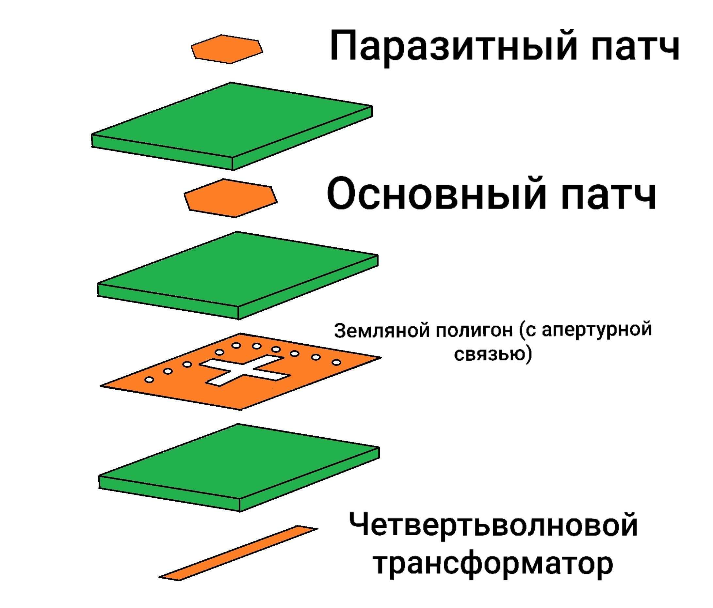
  <br>
  <em>Figure 32. Exploded structural diagram: microstrip feeder stub, ground plane with coupling cross-slot and perforation rings, driven patch, and upper parasitic resonator.</em>
</p>

<p align="center">
  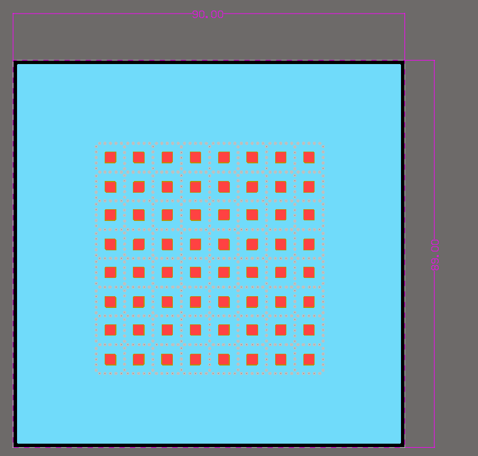
  <br>
  <em>Figure 33. Antenna PCB layout (90.00 x 89.00 mm): 8x8 radiator array surrounded by protective perforation fences and wide ground margins.</em>
</p>

<p align="center">
  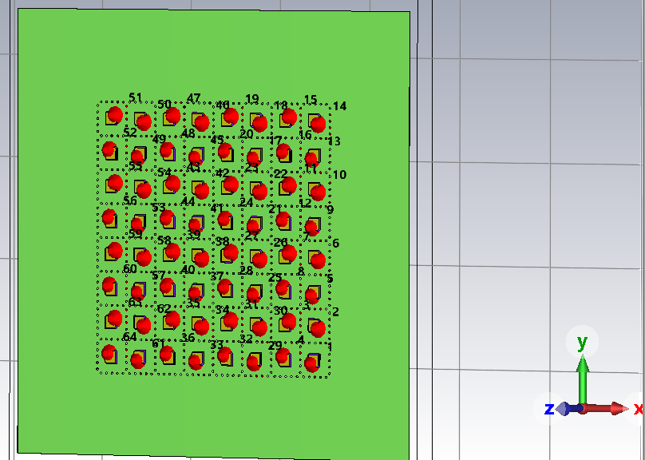
  <br>
  <em>Figure 34. Full-wave CST Studio Suite 3D simulation model of the 8x8 array with all 64 independent waveguide ports labeled.</em>
</p>

### 2. Multi-Port Impedance Matching in the Optimized 8×8 Array (VSWR)
Unlike the preliminary array simulation where mutual coupling caused severe impedance divergence between ports, the final array features tightly clustered VSWR curves across all channels:

Resonance minima reach 1.0 to 1.2 in the vicinity of 28.8 GHz.<br>
Broadband impedance matching meeting the $\text{VSWR} < 2.0$ benchmark is consistently maintained from 28.1 to 29.7 GHz across all 64 ports.

<p align="center">
  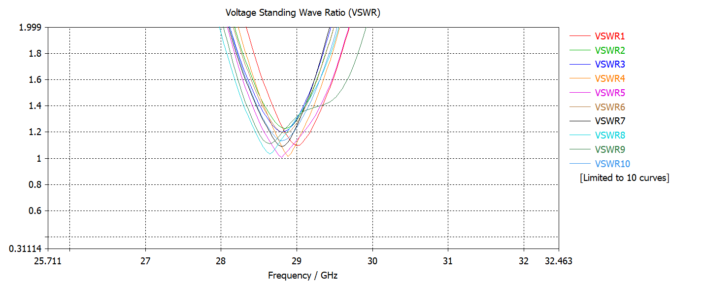
  <br>
  <em>Figure 35. VSWR frequency response across ports of the optimized 8x8 array: uniform matching without edge port detuning.</em>
</p>

### 3. Preservation of Circular Polarization Across the Entire Operating Band
The combination of ground perforation fences and sequential rotation architecture successfully suppresses spurious coupling modes. Across the complete Ka-band operational channel, the Axial Ratio remains safely below the 3.0 dB threshold:

At 28.0 GHz: Broadside axial ratio evaluates to 2.1 dB (completely recovered from the degraded 5.3 dB in the uncompensated array).<br>
At 29.0 GHz: Broadside axial ratio evaluates to 1.6 dB (compared to 3.9 dB in the uncompensated array).<br>
At 30.0 GHz: Broadside axial ratio evaluates to an exceptional 0.7 dB (compared to 2.6 dB with an extremely constricted beamwidth in the uncompensated array).

<p align="center">
  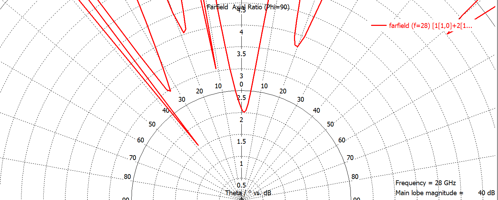
  <br>
  <em>Figure 36. Polar Axial Ratio cut of final 8x8 array at 28 GHz (broadside AR = 2.1 dB).</em>
</p>

<p align="center">
  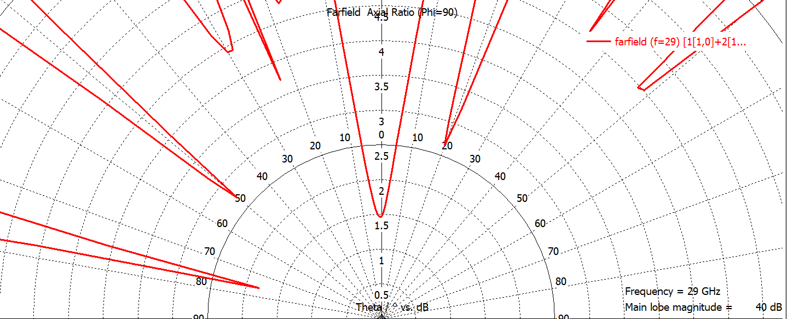
  <br>
  <em>Figure 37. Polar Axial Ratio cut of final 8x8 array at 29 GHz (broadside AR = 1.6 dB).</em>
</p>

<p align="center">
  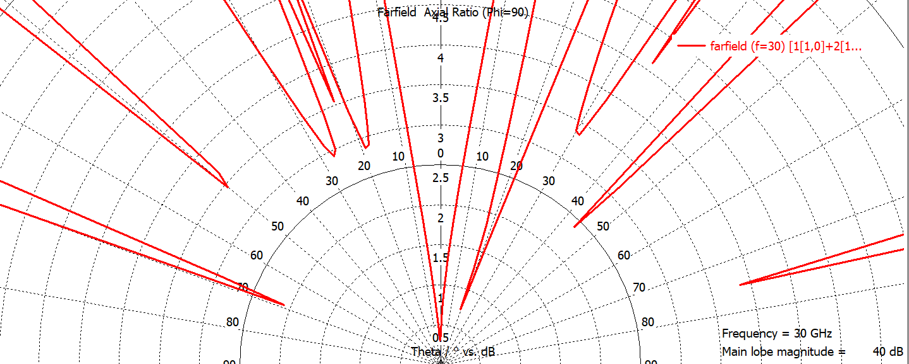
  <br>
  <em>Figure 38. Polar Axial Ratio cut of final 8x8 array at 30 GHz (broadside AR = 0.7 dB).</em>
</p>

### 4. Directivity, Gain, and Radiation Performance
Under uniform array excitation at 29.0 GHz, the antenna array achieves high aperture efficiency:

Realized Gain: 21.8 dBi (improved from 21.3 dBi).<br>
Half-Power Beamwidth (HPBW): $10.0^\circ$.<br>
Side Lobe Level (SLL): $-12.3$ dB.<br>
Radiation Efficiency: 93.5% ($-0.29$ dB).<br>
Total Efficiency: 86.4% ($-0.63$ dB).

<p align="center">
  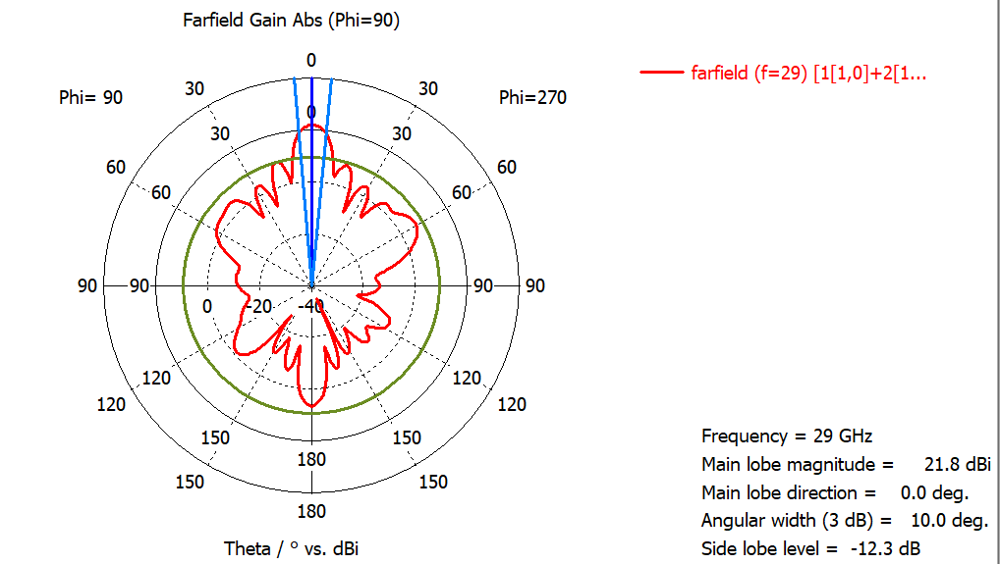
  <br>
  <em>Figure 39. Farfield Polar Gain cut of the final 8x8 array at 29 GHz (Gain = 21.8 dBi, HPBW = 10.0°).</em>
</p>

<p align="center">
  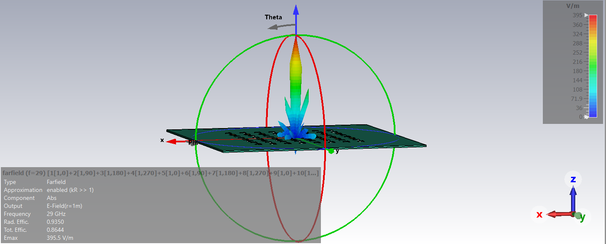
  <br>
  <em>Figure 40. 3D spatial E-field pattern of final 8x8 array at 29 GHz (Emax = 395.5 V/m).</em>
</p>

### 5. Phased Array Electronic Beam Steering
To evaluate compatibility with phased array antennas (PAA) and active electronically scanned arrays (AESA), progressive linear phase shifts were applied across elements:

Beam steered to $0^\circ$ (boresight normal):<br>
Maximum electric field: $E_{\text{max}} = 395$ V/m.<br>
Half-Power Beamwidth: $\text{HPBW} = 9.4^\circ$.<br>
Side Lobe Level: $\text{SLL} = -5.8$ dB.<br>
Axial Ratio: deep minimum $\text{AR} \approx 1.6$ dB oriented strictly along the main beam axis ($\theta = 0^\circ$).

Beam steered to $17^\circ$:<br>
Maximum electric field: $E_{\text{max}} = 391$ V/m.<br>
Half-Power Beamwidth: $\text{HPBW} = 9.9^\circ$.<br>
Side Lobe Level: $\text{SLL} = -5.5$ dB.<br>
Axial Ratio: the high-purity circular polarization sector ($\text{AR} < 3.0$ dB) steers synchronously with the beam, maintaining minimum axial ratio at $\theta = 17^\circ$.

Beam steered to $33^\circ$:<br>
Maximum electric field: $E_{\text{max}} = 325$ V/m.<br>
Half-Power Beamwidth: $\text{HPBW} = 11.7^\circ$.<br>
Side Lobe Level: $\text{SLL} = -6.5$ dB.<br>
Axial Ratio: even under wide-angle steering to $33^\circ$, the axial ratio minimum ($\text{AR} < 3.0$ dB) accurately tracks the steered main lobe peak, ensuring robust circular polarization performance across the full scan sector.

<p align="center">
  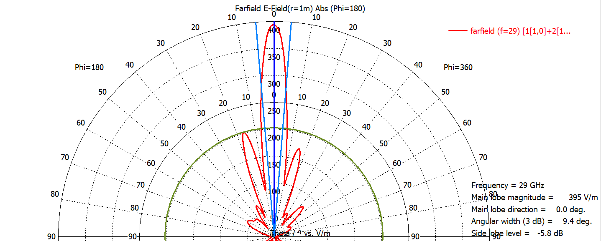
  <br>
  <em>Figure 41. E-field polar cut at 0° boresight: Emax = 395 V/m, HPBW = 9.4°.</em>
</p>

<p align="center">
  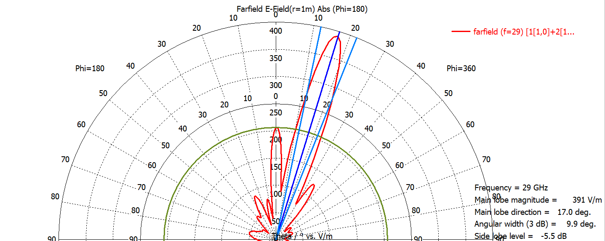
  <br>
  <em>Figure 42. E-field polar cut steered to 17°: Emax = 391 V/m, HPBW = 9.9°.</em>
</p>

<p align="center">
  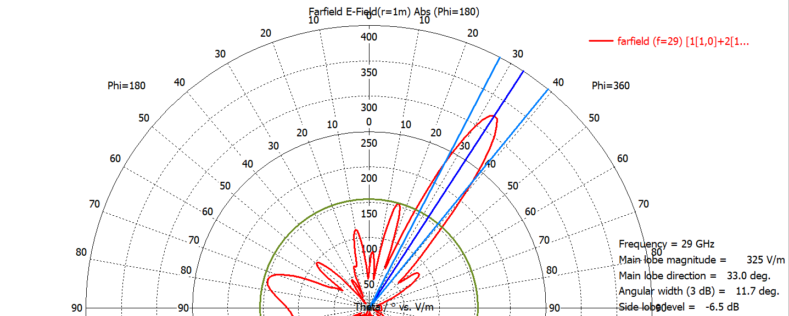
  <br>
  <em>Figure 43. E-field polar cut steered to 33°: Emax = 325 V/m, HPBW = 11.7°.</em>
</p>

<p align="center">
  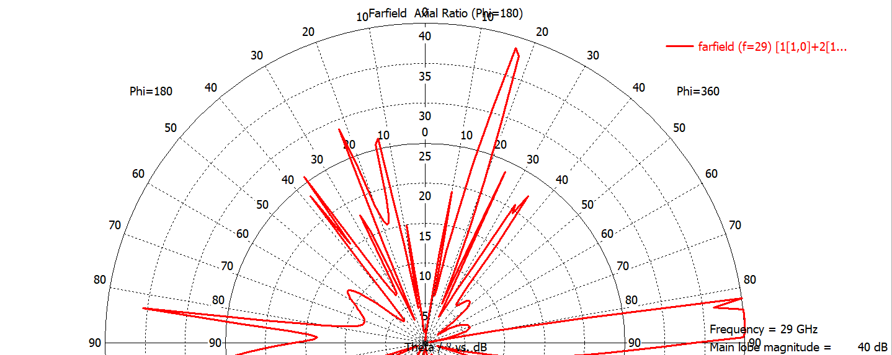
  <br>
  <em>Figure 44. Polar Axial Ratio cut with beam steered to boresight (0°): AR notch aligned with main lobe.</em>
</p>

<p align="center">
  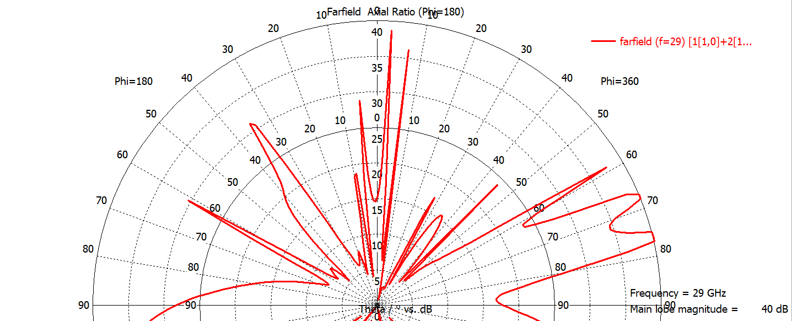
  <br>
  <em>Figure 45. Polar Axial Ratio cut with beam steered to 17°: AR minimum (< 3.0 dB) tracks the scan angle.</em>
</p>

<p align="center">
  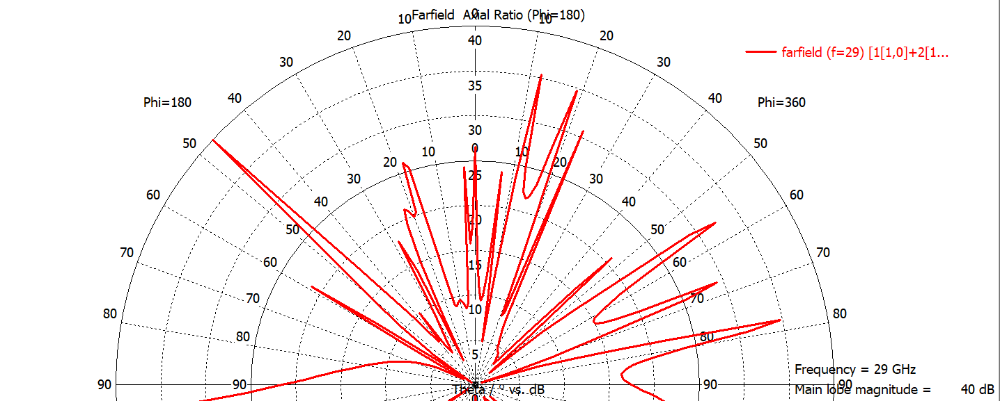
  <br>
  <em>Figure 46. Polar Axial Ratio cut with beam steered to 33°: preservation of circular polarization (< 3.0 dB) under wide-angle steering.</em>
</p>

<p align="center">
  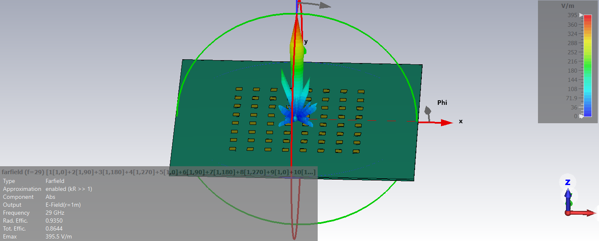
  <br>
  <em>Figure 47. 3D spatial beam steered to boresight normal (0°).</em>
</p>

<p align="center">
  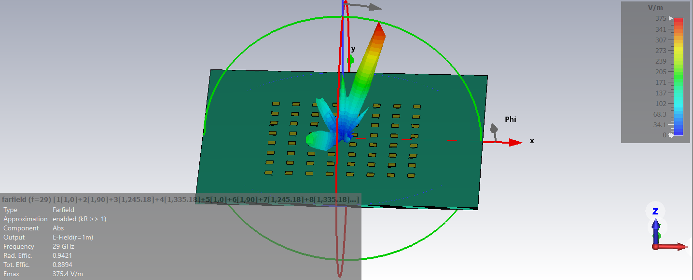
  <br>
  <em>Figure 48. 3D spatial beam electronically steered to 17°.</em>
</p>

<p align="center">
  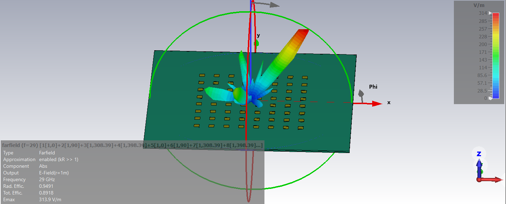
  <br>
  <em>Figure 49. 3D spatial beam electronically steered to 33°.</em>
</p>

## License

Copyright (c) 2026 Ilya Kornilov

This source describes Open Hardware and is licensed under the CERN-OHL-P v2. 
You may redistribute and modify this source and make products using it under 
the terms of the CERN-OHL-P v2 (https://cern.ch/cern-ohl).

This source is distributed WITHOUT ANY EXPRESS OR IMPLIED WARRANTY, 
INCLUDING OF MERCHANTABILITY, SATISFACTORY QUALITY AND FITNESS FOR A 
PARTICULAR PURPOSE. Please see the CERN-OHL-P v2 for applicable conditions.
